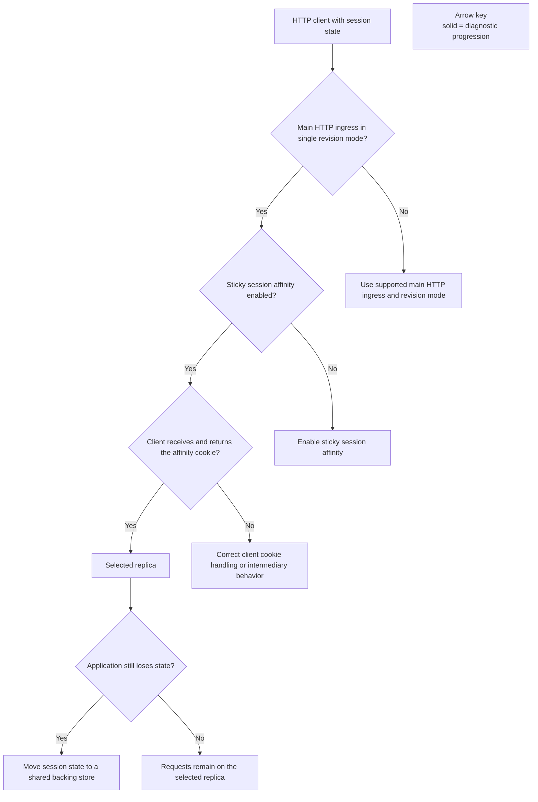

---
content_sources:
  references:
    - type: mslearn-adapted
      url: https://learn.microsoft.com/en-us/azure/container-apps/sticky-sessions
  diagrams:
    - id: session-affinity-failure-flow
      type: flowchart
      source: self-generated
      justification: Diagnostic decision flow synthesized from the documented HTTP ingress sticky-session behavior and its cookie and revision-mode limitations.
      based_on:
        - https://learn.microsoft.com/en-us/azure/container-apps/sticky-sessions
        - https://learn.microsoft.com/en-us/azure/container-apps/ingress-how-to
content_validation:
  status: verified
  last_reviewed: '2026-07-18'
  reviewer: ai-agent
  core_claims:
    - claim: 'Azure Container Apps supports session affinity with `stickySessions.affinity` values `none` and `sticky`.'
      source: https://learn.microsoft.com/en-us/azure/container-apps/ingress-how-to
      verified: true
    - claim: Session affinity is cookie-based for HTTP ingress.
      source: https://learn.microsoft.com/en-us/azure/container-apps/sticky-sessions
      verified: true
---
# Session Affinity Failure

<!-- diagram-id: session-affinity-failure-flow -->


*Figure: Sticky sessions are a supported HTTP routing aid, not a substitute for shared application state.*

## Symptom

- Users lose sign-in context, cart state, or in-memory workflow state between requests.
- The issue appears only after scaling above one replica or during traffic split tests.
- Repeated requests from the same client alternate between different replica identifiers.

Typical evidence:

- [Observed] The app stores state in memory instead of a shared store.
- [Observed] Repeated calls from one browser or client hit different replicas.
- [Correlated] Complaints start when autoscaling or multi-revision routing begins.

## Possible Causes

| Cause | Why it breaks |
|---|---|
| Ingress affinity is `none` | Requests are distributed across replicas as designed. |
| App depends on in-memory state | Load balancing exposes the state-sharing flaw. |
| Canary or multi-revision rollout increases distribution | More possible backends magnify the state-loss symptom. |
| Sticky sessions expected on a non-main HTTP port | The traffic path does not support built-in affinity features. |

## Diagnosis Steps

1. Inspect ingress configuration for sticky sessions.
2. Confirm multiple replicas are active.
3. Send repeated requests from a single client and compare replica IDs, cookies, or app-level session counters.

```bash
az containerapp show \
  --name "$APP_NAME" \
  --resource-group "$RG" \
  --query "properties.configuration.ingress" \
  --output json

az containerapp replica list \
  --name "$APP_NAME" \
  --resource-group "$RG" \
  --output table
```

| Command/Parameter | Purpose |
|---|---|
| `az containerapp show` | Reads sticky-session ingress configuration to verify whether affinity is enabled on the failing app. |
| `--name` (`az containerapp show`) | Inspects `$APP_NAME`, the app whose requests are not returning to the expected replica. |
| `--resource-group` (`az containerapp show`) | Finds the affinity test app in `$RG` before reading its ingress configuration. |
| `--query` (`az containerapp show`) | Exposes the ingress settings where sticky-session affinity is configured, avoiding unrelated app properties. |
| `--output` (`az containerapp show`) | Displays the ingress affinity setting and traffic weights as columns for checking whether sticky sessions are enabled on the routed revision. |
| `az containerapp replica list` | Lists serving replicas so affinity behavior can be distinguished from a single-replica deployment. |
| `--name` (`az containerapp replica list`) | Returns replicas for `$APP_NAME`, the same app used in the cookie-routing test. |
| `--resource-group` (`az containerapp replica list`) | Retrieves serving replicas for `$APP_NAME` from `$RG`. |
| `--output` (`az containerapp replica list`) | Shows replica names and states in table form to confirm that multiple healthy backends can receive the session. |


Interpretation:

- [Observed] If only one replica exists, stickiness cannot explain the issue.
- [Observed] If multiple replicas exist and the same client alternates backends, affinity is disabled or ineffective for the chosen port.
- [Strongly Suggested] If enabling sticky sessions immediately stabilizes the user flow, the app still has an in-memory state dependency.

## Resolution

1. Enable sticky sessions for the affected HTTP ingress if short-term continuity is required.
2. Move session state into a shared system such as Redis, a database, or another shared backing store.
3. Re-test with at least two replicas and the same client cookie path.

```yaml
properties:
  configuration:
    ingress:
      external: true
      targetPort: 8080
      stickySessions:
        affinity: sticky
```

```bash
az containerapp update \
  --name "$APP_NAME" \
  --resource-group "$RG" \
  --yaml "session-affinity-enabled.yaml"
```

| Command/Parameter | Purpose |
|---|---|
| `az containerapp update` | Applies the YAML that enables sticky sessions on the app's HTTP ingress. |
| `--name` (`az containerapp update`) | Updates `$APP_NAME`, whose affinity cookie behavior failed the diagnosis. |
| `--resource-group` (`az containerapp update`) | Directs the sticky-session update to the resource group containing the app that lost client affinity during scale-out. |
| `--yaml` (`az containerapp update`) | Applies `session-affinity-enabled.yaml`, whose ingress block sets sticky-session affinity. |


## Prevention

- Design HTTP apps to be stateless by default.
- Use sticky sessions only as an explicit compatibility choice.
- Test scale-out with real browser or client cookie behavior before release.
- Document when traffic split, scale-out, or reconnect patterns can expose in-memory state assumptions.

## See Also

- [Session Affinity Failure Lab](../../lab-guides/session-affinity-failure.md)
- [WebSocket and gRPC Ingress](websocket-grpc-ingress.md)
- [Ingress in Azure Container Apps](../../../platform/networking/ingress.md)
- [Networking Best Practices](../../../best-practices/networking.md)

## Sources

- [Session affinity in Azure Container Apps](https://learn.microsoft.com/en-us/azure/container-apps/sticky-sessions)
- [Configure ingress in Azure Container Apps](https://learn.microsoft.com/en-us/azure/container-apps/ingress-how-to)
- [Ingress in Azure Container Apps](https://learn.microsoft.com/en-us/azure/container-apps/ingress-overview)
