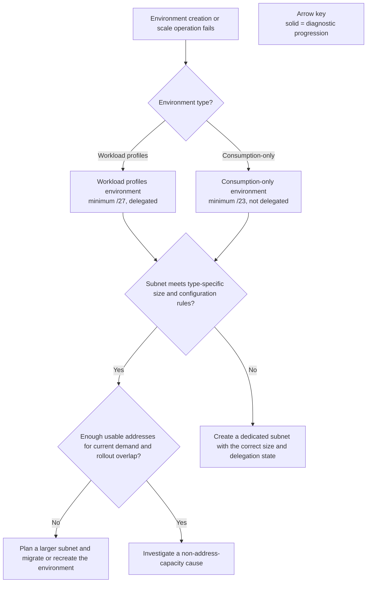

---
content_sources:
  references:
    - type: mslearn-adapted
      url: https://learn.microsoft.com/en-us/azure/container-apps/networking
  diagrams:
    - id: subnet-cidr-exhaustion-flow
      type: flowchart
      source: self-generated
      justification: Diagnostic decision flow synthesized from the documented Container Apps subnet-size, delegation, exclusivity, and IP-consumption rules.
      based_on:
        - https://learn.microsoft.com/en-us/azure/container-apps/networking
        - https://learn.microsoft.com/en-us/azure/container-apps/vnet-custom
content_validation:
  status: verified
  last_reviewed: 2026-07-18
  reviewer: ai-agent
  core_claims:
    - claim: Workload profiles environments require a minimum subnet size of /27 and Consumption-only environments require a minimum subnet size of /23.
      source: https://learn.microsoft.com/en-us/azure/container-apps/networking
      verified: true
    - claim: A custom virtual network deployment requires a subnet dedicated exclusively to the Container Apps environment.
      source: https://learn.microsoft.com/en-us/azure/container-apps/vnet-custom
      verified: true
---
# Subnet CIDR Exhaustion

<!-- diagram-id: subnet-cidr-exhaustion-flow -->


*Figure: Apply the subnet minimum and delegation rule for the actual environment type, then evaluate growth and rollout headroom separately.*

## Symptom

- Managed environment creation fails when the target subnet is too small.
- Scale-out or zero-downtime rollout stalls after the environment already exists because the subnet has no headroom for new replicas or nodes.
- Operators typically see deployment errors immediately after choosing a `/29`, reusing a shared subnet, or packing too many revisions into a small address range.

Typical scenario markers:

- [Observed] The environment subnet is smaller than the Microsoft Learn minimum for the selected environment type.
- [Observed] New revisions stay unhealthy while older revisions still occupy IPs.
- [Inferred] The platform is healthy, but IP capacity is the bottleneck.

## Possible Causes

| Cause | Why it breaks |
|---|---|
| Subnet smaller than the documented minimum | Container Apps rejects unsupported subnet sizes during environment deployment. |
| Dedicated subnet reused for unrelated resources | Available IPs are consumed by resources that should not share the environment subnet. |
| No rollout headroom | Revision overlap temporarily doubles IP demand during zero-downtime deployment. |
| Growth exceeded original plan | Replica count or workload profile node count outgrew the original subnet design. |

## Diagnosis Steps

1. Confirm the subnet prefix and whether the subnet is dedicated to the environment.
2. Confirm the environment type and current VNet configuration.
3. Compare the prefix against the documented minimum and current replica growth expectations.

```bash
az network vnet subnet show \
  --name "snet-aca" \
  --vnet-name "vnet-myapp" \
  --resource-group "$RG" \
  --query "{addressPrefix:addressPrefix, delegations:delegations[].serviceName, routeTable:routeTable.id, networkSecurityGroup:networkSecurityGroup.id}" \
  --output json

az containerapp env show \
  --name "$ACA_ENV_NAME" \
  --resource-group "$RG" \
  --query "{vnetConfiguration:properties.vnetConfiguration, staticIp:properties.staticIp}" \
  --output json
```

| Command/Parameter | Purpose |
|---|---|
| `az network vnet subnet show` | Retrieves the subnet prefix and delegation so available address capacity can be assessed against Container Apps requirements. |
| `--name` (`az network vnet subnet show`) | Inspects the delegated Container Apps subnet named in the command. |
| `--vnet-name` (`az network vnet subnet show`) | Searches `vnet-myapp` for the environment subnet whose CIDR capacity is under investigation. |
| `--resource-group` (`az network vnet subnet show`) | Finds `vnet-myapp` and its delegated subnet in `$RG`. |
| `--query` (`az network vnet subnet show`) | Condenses the subnet prefix, delegation, and routing details needed to judge whether the delegated range can accommodate more infrastructure. |
| `--output` (`az network vnet subnet show`) | Renders the selected prefix and delegation columns as a readable table for the capacity check. |
| `az containerapp env show` | Returns the environment's infrastructure subnet and static IP to confirm which subnet consumes addresses. |
| `--name` (`az containerapp env show`) | Reads `$ACA_ENV_NAME`, the environment consuming addresses from the delegated subnet. |
| `--resource-group` (`az containerapp env show`) | Locates that environment in `$RG` before comparing subnet attachment and static IP. |
| `--query` (`az containerapp env show`) | Pairs the environment VNet configuration with its static IP to confirm which subnet the environment consumes. |
| `--output` (`az containerapp env show`) | Formats the environment subnet ID and static IP as columns that can be compared with the VNet result. |


Interpretation guidance:

- [Observed] If the subnet is `/29`, `/28`, or another value below the documented minimum, the CIDR itself is the primary fault.
- [Observed] If the subnet meets the minimum but rollouts fail only during revision overlap, the issue is headroom rather than raw minimum compliance.
- [Correlated] If failures started right after adding more apps or raising max replicas, growth likely exhausted the subnet.

## Resolution

1. Create a new, larger subnet that is dedicated only to the Container Apps environment.
2. Use `/27` or larger for workload profiles environments, and `/23` or larger for consumption-only environments.
3. Recreate or migrate the environment onto the larger subnet; do not try to force production growth into an undersized shared subnet.
4. Re-run the deployment or rollout after the new subnet is in place.

```bash
az network vnet subnet create \
  --name "snet-aca-large" \
  --vnet-name "vnet-myapp" \
  --resource-group "$RG" \
  --address-prefixes "10.10.0.0/27" \
  --delegations "Microsoft.App/environments"

az containerapp env create \
  --name "$ACA_ENV_NAME" \
  --resource-group "$RG" \
  --location "$LOCATION" \
  --infrastructure-subnet-resource-id "/subscriptions/<subscription-id>/resourceGroups/$RG/providers/Microsoft.Network/virtualNetworks/vnet-myapp/subnets/snet-aca-large"
```

| Command/Parameter | Purpose |
|---|---|
| `az network vnet subnet create` | Allocates a larger delegated subnet to restore address headroom for environment infrastructure and replicas. |
| `--name` (`az network vnet subnet create`) | Creates the replacement subnet `snet-aca-large`. |
| `--vnet-name` (`az network vnet subnet create`) | Creates the replacement delegated subnet inside `vnet-myapp`, where additional address space was reserved. |
| `--resource-group` (`az network vnet subnet create`) | Adds the replacement subnet to `vnet-myapp` in `$RG`. |
| `--address-prefixes` (`az network vnet subnet create`) | Assigns `10.10.0.0/27`, providing the documented minimum range for a workload profiles environment. |
| `--delegations` (`az network vnet subnet create`) | Delegates the subnet to `Microsoft.App/environments` so Container Apps can use it. |
| `az containerapp env create` | Provisions the replacement environment on the expanded subnet because an existing environment cannot be moved in place. |
| `--name` (`az containerapp env create`) | Creates `$ACA_ENV_NAME` on the larger delegated range. |
| `--resource-group` (`az containerapp env create`) | Places the replacement environment in `$RG`. |
| `--location` (`az containerapp env create`) | Deploys the environment in `$LOCATION`, matching the VNet region. |
| `--infrastructure-subnet-resource-id` (`az containerapp env create`) | Attaches the environment to the full ARM ID of `snet-aca-large` rather than the exhausted subnet. |


## Prevention

- Size for growth, not only for day-one deployment.
- Reserve rollout headroom for overlapping revisions.
- Keep the environment subnet dedicated to Container Apps only.
- Review subnet capacity whenever max replicas, workload profiles, or team onboarding increases.

## See Also

- [Subnet CIDR Exhaustion Lab](../../lab-guides/subnet-cidr-exhaustion.md)
- [Networking and CIDR](../../../platform/environments/networking-and-cidr.md)
- [VNet Integration](../../../platform/networking/vnet-integration.md)
- [Environment Design](../../../best-practices/environment-design.md)

## Sources

- [Networking in Azure Container Apps environment](https://learn.microsoft.com/en-us/azure/container-apps/networking)
- [Integrate a virtual network with an Azure Container Apps environment](https://learn.microsoft.com/en-us/azure/container-apps/vnet-custom)
- [Create a Container Apps environment with the Azure CLI](https://learn.microsoft.com/en-us/azure/container-apps/workload-profiles-manage-cli)
