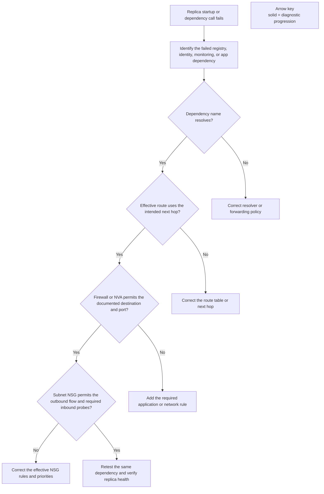

---
content_sources:
  references:
    - type: mslearn-adapted
      url: https://learn.microsoft.com/en-us/azure/container-apps/user-defined-routes
  diagrams:
    - id: udr-nsg-egress-blocked-flow
      type: flowchart
      source: self-generated
      justification: Diagnostic decision flow synthesized from the documented Container Apps UDR, firewall, NSG, DNS, and required outbound dependency rules.
      based_on:
        - https://learn.microsoft.com/en-us/azure/container-apps/user-defined-routes
        - https://learn.microsoft.com/en-us/azure/container-apps/firewall-integration
        - https://learn.microsoft.com/en-us/azure/container-apps/networking
content_validation:
  status: verified
  last_reviewed: 2026-07-18
  reviewer: ai-agent
  core_claims:
    - claim: Workload profiles environments support user-defined routes and egress through NAT Gateway.
      source: https://learn.microsoft.com/en-us/azure/container-apps/networking
      verified: true
    - claim: Restrictive egress for Container Apps must continue to allow required Microsoft dependencies such as registry, identity, and monitoring endpoints.
      source: https://learn.microsoft.com/en-us/azure/container-apps/firewall-integration
      verified: true
---
# UDR and NSG Egress Blocked

<!-- diagram-id: udr-nsg-egress-blocked-flow -->


*Figure: DNS, routing, firewall policy, and NSG policy are distinct evidence gates; changing one does not prove the others.*

## Symptom

- Replicas fail to start, remain unhealthy, or cycle after a new route table, firewall, or NSG change.
- Image pull, managed identity token acquisition, telemetry, or outbound dependency calls time out.
- Operators often notice the failure immediately after forced tunneling or a deny-all outbound rule is introduced.

Common log and platform patterns:

- [Observed] Replica startup fails even though the app image and configuration did not change.
- [Observed] External dependencies such as `mcr.microsoft.com`, ACR, or Microsoft Entra endpoints are unreachable.
- [Correlated] Incident start time matches a UDR, firewall, or NSG rollout.

## Possible Causes

| Cause | Why it breaks |
|---|---|
| Default route sends all egress to a firewall without required allow rules | Container Apps platform dependencies cannot be reached. |
| NSG blocks `AzureLoadBalancer` or platform traffic | Health probes or internal platform paths fail. |
| Firewall or NVA allow-list is incomplete | Registry, identity, or monitoring flows are denied. |
| UDR design applied to the wrong environment type or wrong subnet | Expected routing behavior is absent or inconsistent. |

## Diagnosis Steps

1. Inspect the environment VNet configuration.
2. Inspect the route table and subnet association.
3. Inspect NSG rules for both inbound health probes and outbound dependency traffic.

```bash
az containerapp env show \
  --name "$ACA_ENV_NAME" \
  --resource-group "$RG" \
  --query "properties.vnetConfiguration" \
  --output json

az network route-table route list \
  --route-table-name "rt-aca" \
  --resource-group "$RG" \
  --output table

az network nsg rule list \
  --nsg-name "nsg-aca" \
  --resource-group "$RG" \
  --output table
```

| Command/Parameter | Purpose |
|---|---|
| `az containerapp env show` | Reads the infrastructure subnet attachment that determines which route table and NSG govern environment egress. |
| `--name` (`az containerapp env show`) | Inspects `$ACA_ENV_NAME`, the environment whose outbound connections are being blocked. |
| `--resource-group` (`az containerapp env show`) | Reads `$ACA_ENV_NAME` from `$RG` before tracing its infrastructure subnet. |
| `--query` (`az containerapp env show`) | Limits the output to the environment's VNet attachment so subsequent route and NSG checks use the correct subnet. |
| `--output` (`az containerapp env show`) | Prints the environment subnet ID in table form so the subsequent route and NSG checks target the same network. |
| `az network route-table route list` | Lists effective UDR entries to identify a default route or next hop that diverts Container Apps egress. |
| `--route-table-name` (`az network route-table route list`) | Inspects `rt-aca`, the route table expected on the environment subnet. |
| `--resource-group` (`az network route-table route list`) | Locates `rt-aca` in `$RG` for forced-tunnel review. |
| `--output` (`az network route-table route list`) | Presents route prefixes and next-hop targets as columns for tracing the blocked outbound path. |
| `az network nsg rule list` | Lists outbound NSG priorities and actions to locate the rule denying required egress. |
| `--nsg-name` (`az network nsg rule list`) | Inspects `nsg-aca`, the security group applied to the Container Apps subnet. |
| `--resource-group` (`az network nsg rule list`) | Reads rules from `nsg-aca` in `$RG`. |
| `--output` (`az network nsg rule list`) | Displays the NSG rule inventory as columns so outbound priorities and actions can be compared quickly. |


Validate against these minimum checks:

- [Observed] A forced-tunnel route with no matching firewall allows strongly supports the hypothesis.
- [Observed] Missing `AzureLoadBalancer` inbound allowance supports health-probe failure.
- [Strongly Suggested] If multiple apps fail at once after a networking change, treat the network path as the primary suspect before blaming application code.

## Resolution

1. Allow required outbound dependencies for image pull, Microsoft Entra token acquisition, and monitoring.
2. Allow inbound `AzureLoadBalancer` health probes and required Container Apps infrastructure traffic on the environment subnet.
3. Retest with one canary app before broad rollout.

```bash
az network nsg rule create \
  --name "allow-azure-load-balancer" \
  --nsg-name "nsg-aca" \
  --resource-group "$RG" \
  --priority 100 \
  --direction Inbound \
  --access Allow \
  --protocol Tcp \
  --source-address-prefixes "AzureLoadBalancer" \
  --source-port-ranges "*" \
  --destination-address-prefixes "*" \
  --destination-port-ranges "30000-32767"

az network nsg rule create \
  --name "allow-aca-outbound" \
  --nsg-name "nsg-aca" \
  --resource-group "$RG" \
  --priority 110 \
  --direction Outbound \
  --access Allow \
  --protocol Tcp \
  --source-address-prefixes "*" \
  --source-port-ranges "*" \
  --destination-address-prefixes "AzureActiveDirectory" "AzureMonitor" "MicrosoftContainerRegistry" \
  --destination-port-ranges "443"
```

| Command/Parameter | Purpose |
|---|---|
| `az network nsg rule create` | Adds the outbound allow rule required for the previously blocked destination and port. |
| `--name` (`az network nsg rule create`) | Creates `allow-azure-load-balancer` and `allow-aca-outbound`, the two missing allowances shown in the fence. |
| `--nsg-name` (`az network nsg rule create`) | Places the corrective rule in `nsg-aca`, where the denying policy was identified. |
| `--resource-group` (`az network nsg rule create`) | Adds both rules to `nsg-aca` in `$RG`. |
| `--priority` (`az network nsg rule create`) | Assigns priority `100` to health probes and `110` to required outbound dependencies. |
| `--direction` (`az network nsg rule create`) | Makes the first rule `Inbound` and the dependency rule `Outbound`. |
| `--access` (`az network nsg rule create`) | Allows traffic matching either correction rule. |
| `--protocol` (`az network nsg rule create`) | Restricts both allowances to `Tcp`, matching probe and HTTPS traffic. |
| `--source-address-prefixes` (`az network nsg rule create`) | Accepts health probes from `AzureLoadBalancer` and outbound flows from any subnet source. |
| `--source-port-ranges` (`az network nsg rule create`) | Accepts ephemeral source ports for both traffic directions. |
| `--destination-address-prefixes` (`az network nsg rule create`) | Sends probe traffic to any backend and outbound traffic only to the listed Azure service tags. |
| `--destination-port-ranges` (`az network nsg rule create`) | Opens `30000-32767` for platform probes and `443` for identity, monitoring, and registry calls. |


If a firewall or NVA is in the path, mirror the same dependency categories there and include required FQDNs such as `mcr.microsoft.com`, `login.microsoftonline.com`, and your ACR login server.

## Prevention

- Design UDR, NSG, firewall, and registry rules as one change set.
- Validate forced tunneling with a canary app before production rollout.
- Keep a documented dependency allow-list for image pull, identity, telemetry, and private endpoints.
- Reconfirm route and NSG posture whenever the environment subnet or firewall policy changes.

## See Also

- [UDR and NSG Egress Blocked Lab](../../lab-guides/udr-nsg-egress-blocked.md)
- [Egress Control](../../../platform/networking/egress-control.md)
- [ACR Network Path Selection](../../../platform/networking/acr-network-path-selection.md)
- [Networking in Azure Container Apps](../../../platform/networking/index.md)
- [Deployment Networking Operations](../../../operations/deployment/networking.md)

## Sources

- [User-defined routes in Azure Container Apps](https://learn.microsoft.com/en-us/azure/container-apps/user-defined-routes)
- [Networking in Azure Container Apps environment](https://learn.microsoft.com/en-us/azure/container-apps/networking)
- [Use Azure Firewall with Azure Container Apps](https://learn.microsoft.com/en-us/azure/container-apps/firewall-integration)
