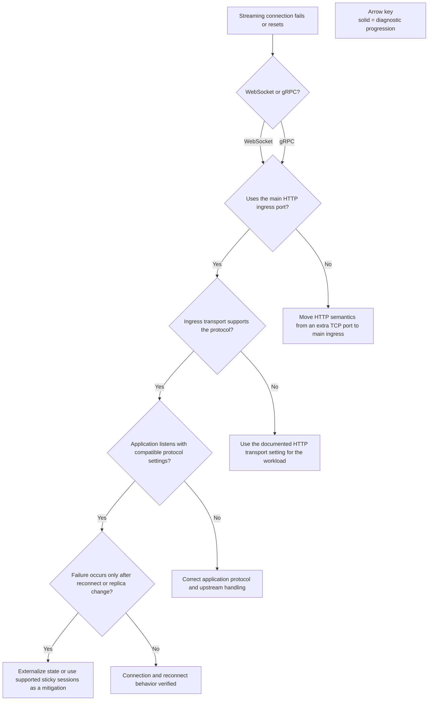

---
content_sources:
  references:
    - type: mslearn-adapted
      url: https://learn.microsoft.com/en-us/azure/container-apps/ingress-overview
  diagrams:
    - id: websocket-grpc-ingress-flow
      type: flowchart
      source: self-generated
      justification: Diagnostic decision flow synthesized from the documented HTTP ingress transport, HTTP/2, WebSocket, gRPC, and sticky-session behavior.
      based_on:
        - https://learn.microsoft.com/en-us/azure/container-apps/ingress-overview
        - https://learn.microsoft.com/en-us/azure/container-apps/ingress-how-to
        - https://learn.microsoft.com/en-us/azure/container-apps/sticky-sessions
content_validation:
  status: verified
  last_reviewed: '2026-07-18'
  reviewer: ai-agent
  core_claims:
    - claim: Azure Container Apps supports ingress transport values `auto`, `http`, `http2`, and `tcp`.
      source: https://learn.microsoft.com/en-us/azure/container-apps/ingress-how-to
      verified: true
    - claim: Built-in HTTP features such as session affinity are supported on the main HTTP ingress port, not on extra TCP ports used as additional port mappings.
      source: https://learn.microsoft.com/en-us/azure/container-apps/ingress-overview
      verified: true
---
# WebSocket and gRPC Ingress

<!-- diagram-id: websocket-grpc-ingress-flow -->


*Figure: Protocol transport and reconnect state are separate concerns; session affinity cannot repair an incompatible gRPC or WebSocket configuration.*

## Symptom

- WebSocket clients connect but reconnect to a different replica and lose in-memory state.
- gRPC clients fail negotiation or fall back incorrectly when ingress transport is not configured for HTTP/2.
- Teams often report intermittent stream resets even though ordinary HTTP requests still work.

Typical evidence:

- [Observed] Browser or client errors mention upgrade, stream reset, or protocol mismatch.
- [Observed] Ingress configuration shows `transport` left at `auto` or `http` for a gRPC workload.
- [Correlated] Failures become visible only when multiple replicas are active or reconnects occur.

## Possible Causes

| Cause | Why it breaks |
|---|---|
| gRPC app not using `http2` transport | End-to-end HTTP/2 expectations are not explicit. |
| Stateful WebSocket workflow depends on replica stickiness | Reconnects land on a different replica and lose in-memory state. |
| HTTP workload placed on an extra TCP port | Built-in HTTP features such as session affinity are unavailable there. |
| Workload design assumes connection-local state survives failover | Platform routing behaves correctly, but the app is not resilient to replica changes. |

## Diagnosis Steps

1. Inspect current ingress configuration.
2. Confirm whether the workload uses the main HTTP ingress port or an extra TCP port.
3. Reproduce with more than one replica to determine whether the issue is transport-related or affinity-related.

```bash
az containerapp show \
  --name "$APP_NAME" \
  --resource-group "$RG" \
  --query "properties.configuration.ingress" \
  --output json

az containerapp replica list \
  --name "$APP_NAME" \
  --resource-group "$RG" \
  --output table
```

| Command/Parameter | Purpose |
|---|---|
| `az containerapp show` | Reads ingress transport and target-port settings before attributing a failed WebSocket or gRPC upgrade to the application. |
| `--name` (`az containerapp show`) | Selects the Container App whose ingress protocol settings are being compared with the failing client request. |
| `--resource-group` (`az containerapp show`) | Finds that app in `$RG`, keeping the ingress diagnosis within the intended deployment boundary. |
| `--query` (`az containerapp show`) | Focuses the response on ingress protocol and transport settings that govern WebSocket or gRPC upgrades. |
| `--output` (`az containerapp show`) | Preserves nested ingress transport fields as JSON for protocol and target-port inspection. |
| `az containerapp replica list` | Lists current replicas to distinguish protocol negotiation failures from an app that has no healthy backend. |
| `--name` (`az containerapp replica list`) | Requests replicas for `$APP_NAME`, the backend expected to receive the upgraded connection. |
| `--resource-group` (`az containerapp replica list`) | Resolves the `az containerapp replica list` target from the resource group used by the diagnosis steps workflow, alongside the related resources in this command block. |
| `--output` (`az containerapp replica list`) | Uses a table to compare replica readiness before treating the failure as protocol-specific. |


Interpretation:

- [Observed] gRPC plus `transport: http` is a direct configuration mismatch.
- [Observed] WebSocket reconnect failures that appear only with multiple replicas suggest lost state rather than basic reachability failure.
- [Strongly Suggested] If the app uses an extra TCP port for HTTP semantics, move that traffic back to the main ingress port before debugging higher layers.

## Resolution

1. Use `transport: http2` for gRPC workloads.
2. Keep browser-oriented HTTP features, including session affinity, on the main ingress port.
3. Enable sticky sessions only when the WebSocket workflow still depends on in-memory replica state.
4. Prefer making streaming workloads stateless or externally stateful over relying on affinity indefinitely.

```yaml
properties:
  configuration:
    ingress:
      external: true
      targetPort: 8080
      transport: http2
      stickySessions:
        affinity: sticky
```

```bash
az containerapp update \
  --name "$APP_NAME" \
  --resource-group "$RG" \
  --yaml "websocket-grpc-ingress-fixed.yaml"
```

| Command/Parameter | Purpose |
|---|---|
| `az containerapp update` | Applies the reviewed YAML that corrects ingress transport settings for WebSocket or gRPC traffic. |
| `--name` (`az containerapp update`) | Updates `$APP_NAME`, the app whose ingress negotiation failed during diagnosis. |
| `--resource-group` (`az containerapp update`) | Resolves the affected app from `$RG` before applying the corrected ingress YAML. |
| `--yaml` (`az containerapp update`) | Applies `websocket-grpc-ingress-fixed.yaml`, which carries the corrected ingress transport and port configuration. |


## Prevention

- Declare ingress transport explicitly for every gRPC app.
- Keep WebSocket and gRPC state outside the replica when possible.
- Treat sticky sessions as a tactical compatibility aid, not a primary architecture pattern.
- Test reconnect behavior with two or more replicas before production rollout.

## See Also

- [WebSocket and gRPC Ingress Lab](../../lab-guides/websocket-grpc-ingress.md)
- [Ingress in Azure Container Apps](../../../platform/networking/ingress.md)
- [Session Affinity Failure](session-affinity-failure.md)
- [Networking Best Practices](../../../best-practices/networking.md)

## Sources

- [Ingress in Azure Container Apps](https://learn.microsoft.com/en-us/azure/container-apps/ingress-overview)
- [Configure ingress in Azure Container Apps](https://learn.microsoft.com/en-us/azure/container-apps/ingress-how-to)
- [Session affinity in Azure Container Apps](https://learn.microsoft.com/en-us/azure/container-apps/sticky-sessions)
