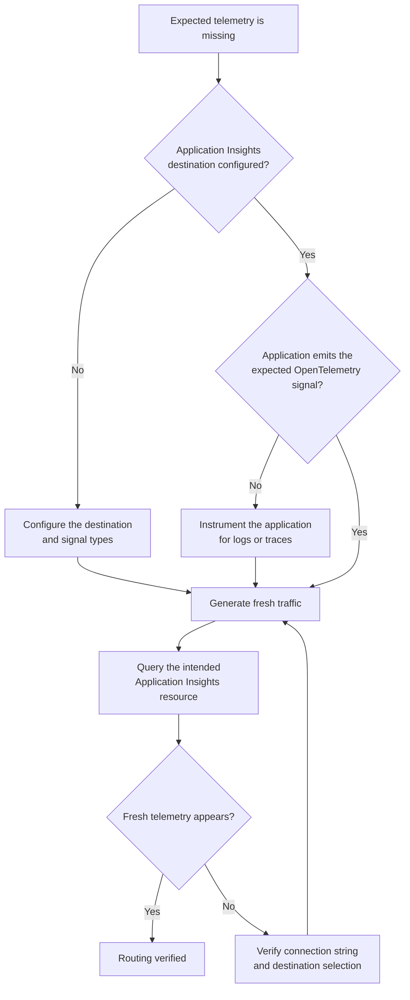

---
content_sources:
  references:
    - type: mslearn-adapted
      url: https://learn.microsoft.com/en-us/azure/container-apps/opentelemetry-agents
    - type: mslearn-adapted
      url: https://learn.microsoft.com/en-us/azure/azure-monitor/app/connection-strings
  diagrams:
    - id: appinsights-connection-string-missing-flow
      type: flowchart
      source: mslearn-adapted
      based_on:
        - https://learn.microsoft.com/en-us/azure/container-apps/opentelemetry-agents
        - https://learn.microsoft.com/en-us/azure/container-apps/observability
content_validation:
  status: verified
  last_reviewed: 2026-07-18
  reviewer: ai-agent
  core_claims:
    - claim: Azure Container Apps can send OpenTelemetry data to Application Insights when telemetry destinations are configured.
      source: https://learn.microsoft.com/en-us/azure/container-apps/opentelemetry-agents
      verified: true
    - claim: Application Insights uses connection strings to associate telemetry with a specific resource.
      source: https://learn.microsoft.com/en-us/azure/azure-monitor/app/connection-strings
      verified: true
---
# Application Insights Connection String Missing

Use this playbook when traffic reaches the app but expected traces, requests, or logs do not appear in Application Insights.

## Symptom

- The app responds successfully, but `requests`, `traces`, or `exceptions` stay empty in Application Insights.
- Operators expect telemetry because the environment or app was recently configured for Application Insights.
- A deployment changed environment variables or secrets and telemetry stopped without affecting the primary request path.

## Possible Causes

- No valid Application Insights connection string is configured for the telemetry path being used.
- The environment telemetry destination exists, but the app itself is not instrumented to emit the signal you expect.
- The app uses a secret reference or environment variable name that no longer resolves correctly.
- Operators are checking the wrong Application Insights resource.
- Telemetry was enabled at the environment level, but no new traffic was generated after the change.

## Diagnosis Steps

<!-- diagram-id: appinsights-connection-string-missing-flow -->


*Figure: Configuration and instrumentation are separate prerequisites; the managed agent routes only signals the application emits.*

1. Confirm the environment telemetry configuration.

    ```bash
    az containerapp env telemetry app-insights show \
        --name "$ACA_ENV_NAME" \
        --resource-group "$RG" \
        --output json
    ```

    | Command or parameter | Purpose |
    |---|---|
    | `az containerapp env telemetry app-insights show` | Read the environment's telemetry configuration to determine whether Application Insights is connected and which signal types are enabled. |
    | `--name` | Specify the Container Apps environment name to configure telemetry. |
    | `--resource-group` | Specify the resource group containing the environment. |
    | `--output json` | Return structured JSON so the connection string metadata, enabled signal types (traces, logs), and Application Insights resource reference are all visible. |

2. Inspect the container app environment variable definitions and secret references.

    ```bash
    az containerapp show \
        --name "$APP_NAME" \
        --resource-group "$RG" \
        --query "properties.template.containers[0].env[].{name:name,secretRef:secretRef}" \
        --output json
    ```

    | Command or parameter | Purpose |
    |---|---|
    | `az containerapp show` | Read the container app's configuration to verify it defines the environment variables or secrets that hold the Application Insights connection string or SDK configuration. |
    | `--name` | Specify the container app by name. |
    | `--resource-group` | Specify the resource group where the container app is deployed. |
    | `--query "properties.template.containers[0].env[].{name:name,secretRef:secretRef}"` | Extract only the environment variables and their secret references; if the app's telemetry configuration depends on a secret, verify the reference name matches an existing secret. |
    | `--output json` | Return JSON for reliable field extraction. |

3. Verify that you are querying the intended Application Insights component.

    ```bash
    az monitor app-insights component show \
        --app "$APPINSIGHTS_NAME" \
        --resource-group "$RG" \
        --query "{appId:appId,name:name,location:location}" \
        --output json
    ```

    | Command or parameter | Purpose |
    |---|---|
    | `az monitor app-insights component show` | Fetch the Application Insights resource's metadata, including the application ID, name, and region, to confirm you are querying the correct telemetry destination. |
    | `--app` | Specify the Application Insights resource by name. |
    | `--resource-group` | Specify the resource group where the Application Insights resource is deployed. |
    | `--query "{appId:appId,name:name,location:location}"` | Extract the application ID (used in query operations), the friendly name, and the region; confirms you are querying the intended resource. |
    | `--output json` | Format as JSON so the template structure and secret references are clearly visible. |

4. Generate fresh traffic after configuration changes.

    ```bash
    curl --silent --show-error "$APP_URL"
    ```

5. Query recent request and trace volume.

    ```kusto
    requests
    | where timestamp > ago(30m)
    | summarize requestCount=count() by cloud_RoleName
    | order by requestCount desc
    ```

    ```kusto
    traces
    | where timestamp > ago(30m)
    | summarize traceCount=count() by cloud_RoleName
    | order by traceCount desc
    ```

6. If you prefer a CLI verification path, run the Application Insights query directly.

    ```bash
    az monitor app-insights query \
        --app "$APPINSIGHTS_NAME" \
        --resource-group "$RG" \
        --analytics-query "requests | where timestamp > ago(30m) | summarize count() by cloud_RoleName" \
        --output table
    ```

    | Command or parameter | Purpose |
    |---|---|
    | `az monitor app-insights query` | Run the KQL query via the CLI to eliminate any possibility that the portal is filtering or misrepresenting the results. |
    | `--app` | Identify the Application Insights component during resolution. |
    | `--resource-group` | Specify the resource group where the Application Insights telemetry destination is deployed. |
    | `--analytics-query` | Execute a 30-minute time-scoped query; a non-zero result confirms telemetry is flowing, while zero rows suggests a configuration or instrumentation problem. |
    | `--output table` | Return results as a human-readable table for quick visual confirmation. |

## Resolution

1. Configure the correct connection string on the telemetry path you actually use.

    ```bash
    az containerapp env telemetry app-insights set \
        --name "$ACA_ENV_NAME" \
        --resource-group "$RG" \
        --connection-string "$APPLICATIONINSIGHTS_CONNECTION_STRING" \
        --enable-open-telemetry-traces true \
        --enable-open-telemetry-logs true
    ```

    | Command or parameter | Purpose |
    |---|---|
    | `az containerapp env telemetry app-insights set` | Configure the environment to collect and forward OpenTelemetry signals to the specified Application Insights resource. |
    | `--name` | Name the telemetry environment. |
    | `--resource-group` | Specify the resource group in which both the environment and Application Insights resources are deployed. |
    | `--connection-string` | Provide the connection string that identifies the Application Insights resource and authenticates telemetry writes; the managed OpenTelemetry agent uses this to route data. |
    | `--enable-open-telemetry-traces true` | Enable the managed agent's traces pipeline so distributed traces from the app are collected and forwarded. |
    | `--enable-open-telemetry-logs true` | Enable the managed agent's structured logs pipeline so application logs are collected as telemetry. |

2. If the application uses the Application Insights SDK directly, restore the `APPLICATIONINSIGHTS_CONNECTION_STRING` environment variable or its referenced secret in the app definition.
3. Generate fresh requests after the change and re-query `requests` and `traces` over the last 15 to 30 minutes.
4. If telemetry still does not appear, treat the issue as an instrumentation-path problem rather than only a missing connection string problem. Verify that your application code actually instantiates the Application Insights SDK and that the instrumentation runs before any requests are processed.

## Prevention

- Store the connection string in a secret-backed workflow instead of hard-coding it in ad hoc commands.
- After each deployment, validate both the configuration state and the presence of fresh telemetry.
- Document whether the workload depends on environment-level OpenTelemetry, SDK-based instrumentation, or both.
- Keep one saved query for `requests` and one for `traces` so missing telemetry is detected early.
- Avoid sharing raw CLI output that could include literal environment variable values or telemetry configuration details.

## See Also

- [Application Insights Connection String Missing Lab](../../lab-guides/appinsights-connection-string-missing.md)
- [Observability Tracing Lab](../../lab-guides/observability-tracing.md)
- [Diagnostic Settings Missing](diagnostic-settings-missing.md)
- [Log Analytics Ingestion Gap](log-analytics-ingestion-gap.md)

## Sources

- [Collect and read OpenTelemetry data in Azure Container Apps](https://learn.microsoft.com/en-us/azure/container-apps/opentelemetry-agents)
- [Observability in Azure Container Apps](https://learn.microsoft.com/en-us/azure/container-apps/observability)
- [Connection strings in Application Insights](https://learn.microsoft.com/en-us/azure/azure-monitor/app/connection-strings)
