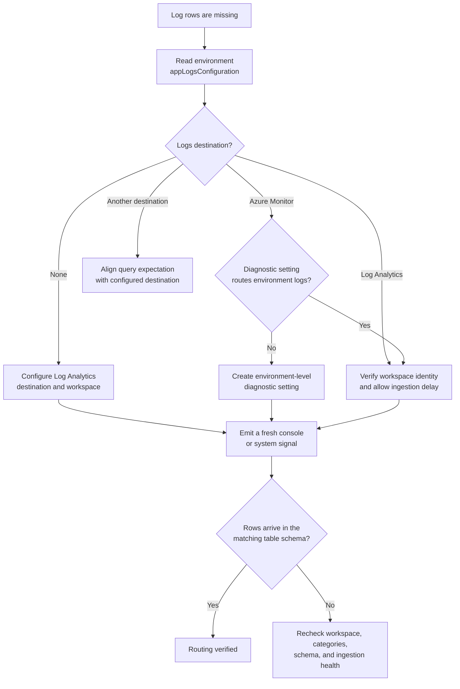

---
content_sources:
  references:
    - type: mslearn-adapted
      url: https://learn.microsoft.com/en-us/azure/container-apps/log-options
    - type: mslearn-adapted
      url: https://learn.microsoft.com/en-us/azure/container-apps/log-monitoring?tabs=bash
  diagrams:
    - id: diagnostic-settings-missing-flow
      type: flowchart
      source: mslearn-adapted
      based_on:
        - https://learn.microsoft.com/en-us/azure/container-apps/log-options
        - https://learn.microsoft.com/en-us/azure/container-apps/log-monitoring?tabs=bash
content_validation:
  status: verified
  last_reviewed: '2026-07-18'
  reviewer: ai-agent
  core_claims:
    - claim: Azure Container Apps lets you configure logging options at the environment level, and when Azure Monitor is the logs destination you can configure diagnostic settings at both the environment level and the container app level.
      source: https://learn.microsoft.com/en-us/azure/container-apps/log-options
      verified: true
    - claim: When you use Log Analytics for log monitoring, the Container Apps environment includes a Log Analytics workspace that stores system and application log data from all container apps running in the environment.
      source: https://learn.microsoft.com/en-us/azure/container-apps/log-monitoring?tabs=bash
      verified: true
---
# Diagnostic Settings Missing

Use this playbook when no `ContainerAppConsoleLogs_CL` or `ContainerAppSystemLogs_CL` rows appear in Log Analytics for any app in a Container Apps environment, and the environment was provisioned via IaC (Bicep, ARM, or Terraform) or via a Portal flow that did not configure the log destination. The primary scenario is an environment whose `properties.appLogsConfiguration` was omitted at provisioning time and now reads `destination: null` on the live resource. In that state, environment-level log routing to Log Analytics is missing for every app in the environment. A variant scenario where the environment is configured for `destination: azure-monitor` but the downstream `Microsoft.Insights/diagnosticSettings` resource was never created is covered at the end.

## Symptom

- `az containerapp env show --query "properties.appLogsConfiguration"` returns `{"destination": null, "logAnalyticsConfiguration": null}` on the environment that should be writing to Log Analytics.
- KQL queries against `ContainerAppConsoleLogs_CL` and `ContainerAppSystemLogs_CL` return `BadArgumentError: SEM0100 'where' operator: Failed to resolve table` — the tables never materialized in the workspace because no log data has ever been written to them.
- A newly created environment or a newly created app inside an existing environment shows no logs after traffic, restarts, or `RevisionReady` events, and the silence is uniform across every app in the environment (not isolated to one app).
- The Log Analytics workspace exists and is otherwise healthy (other resources in the same workspace continue to ingest), but no Container Apps tables appear in the workspace schema.

## Possible Causes

- The Bicep, ARM, or Terraform module that creates the environment omitted the `appLogsConfiguration` property entirely, so the live environment lands at `destination: null`.
- A subsequent `az deployment group create` reverted a live fix back to `destination: null` because the IaC declaration was never updated to match the manually-applied fix.
- The environment was created via Portal but the operator skipped the log destination step in the creation wizard.
- The environment is configured for `destination: azure-monitor` but the downstream `Microsoft.Insights/diagnosticSettings` resource was never created on the environment resource (variant scenario — see the dedicated section below).
- The environment is configured for a different destination entirely (`azure-blob-storage`, no destination, etc.) and the team expected Log Analytics ingestion by default.

## Diagnosis Steps

<!-- diagram-id: diagnostic-settings-missing-flow -->


*Figure: Direct Log Analytics routing and Azure Monitor diagnostic settings are distinct configuration paths; both require a fresh post-change signal for verification.*

1. Read the environment's `appLogsConfiguration` — this is the single most important check.

    ```bash
    az containerapp env show \
        --subscription "$SUBSCRIPTION_ID" \
        --resource-group "$RG" \
        --name "$ACA_ENV_NAME" \
        --query "properties.appLogsConfiguration" \
        --output json
    ```

    | Command or parameter | Purpose |
    |---|---|
    | `az containerapp env show` | Read the live `appLogsConfiguration` property to identify whether the environment is currently routing logs. |
    | `--subscription` | Specify the subscription containing the Container Apps environment (required for Azure CLI cross-subscription operations). |
    | `--resource-group` | Reference the resource group in which the environment resource was created. |
    | `--name` | Identify the specific Container Apps environment by its name. |
    | `--query` | Filter the output to show only `properties.appLogsConfiguration`, the node that controls where logs are routed. |
    | `--output json` | Return structured JSON so the full destination configuration (including workspace identity) is readable. |

2. If `destination` is `null`, you are in the primary scenario. Capture the workspace resource ID and customer ID you will need for the fix.

    ```bash
    az monitor log-analytics workspace show \
        --subscription "$SUBSCRIPTION_ID" \
        --resource-group "$RG" \
        --workspace-name "$WORKSPACE_NAME" \
        --query "{id:id, customerId:customerId}" \
        --output json
    ```

    | Command or parameter | Purpose |
    |---|---|
    | `az monitor log-analytics workspace show` | Fetch the workspace resource to obtain both the customer ID and ARM resource ID required for the fix. |
    | `--subscription` | Specify the subscription in which the Log Analytics workspace is deployed. |
    | `--resource-group` | Reference the resource group containing the Log Analytics workspace. |
    | `--workspace-name` | Name the specific Log Analytics workspace to query. |
    | `--query` | Project both `id` (for diagnostic settings) and `customerId` (for log analytics configuration), each serving different purposes downstream. |
    | `--output json` | Format as JSON for reliable key-value extraction in downstream steps. |

3. If `destination` is `azure-monitor`, you are in the variant scenario. List diagnostic settings on the environment resource.

    ```bash
    ENV_RESOURCE_ID=$(az containerapp env show \
        --subscription "$SUBSCRIPTION_ID" \
        --resource-group "$RG" \
        --name "$ACA_ENV_NAME" \
        --query "id" \
        --output tsv)
    az monitor diagnostic-settings list \
        --resource "$ENV_RESOURCE_ID" \
        --output json
    ```

    | Command or parameter | Purpose |
    |---|---|
    | `az containerapp env show` | Retrieve the environment's ARM resource ID. |
    | `--subscription` | Select the subscription that owns the environment whose diagnostic settings are being inspected. |
    | `--resource-group` | Locate the resource group containing the Container Apps environment. |
    | `--name` | Identify the environment whose ARM resource ID is assigned to `ENV_RESOURCE_ID`. |
    | `--query` | Project the environment `id` required as the diagnostic-settings resource target. |
    | `--output` | Emit unquoted TSV for `ENV_RESOURCE_ID`, then render the diagnostic-settings list as JSON. |
    | `az monitor diagnostic-settings list` | List any `Microsoft.Insights/diagnosticSettings` resources already attached to the environment that route to Log Analytics. |
    | `--resource` | Point to the environment resource by its full ARM ID. |

4. Confirm the silence is workspace-wide by running the canonical KQL on both tables.

    ```kusto
    let AppName = "ca-myapp";
    ContainerAppConsoleLogs_CL
    | where ContainerAppName_s == AppName
    | where TimeGenerated > ago(30m)
    | project TimeGenerated, RevisionName_s, Log_s
    | order by TimeGenerated desc
    ```

    ```kusto
    let AppName = "ca-myapp";
    ContainerAppSystemLogs_CL
    | where ContainerAppName_s == AppName
    | where TimeGenerated > ago(30m)
    | project TimeGenerated, RevisionName_s, Reason_s, Log_s
    | order by TimeGenerated desc
    ```

    A `BadArgumentError: SEM0100 'where' operator: Failed to resolve table` response on both queries is the strongest signal that the tables never materialized in this workspace, which is consistent with the primary scenario where the environment never had a log destination configured. A "0 rows" response on tables that exist means a different cause (workspace mismatch, app filter mismatch, ingestion lag).

## Resolution

### Primary scenario — environment with `destination: null`

1. Update the environment to set the Log Analytics destination. The shared key is required and must be passed at command-time; do not persist it.

    ```bash
    WORKSPACE_CUSTOMER_ID=$(az monitor log-analytics workspace show \
        --subscription "$SUBSCRIPTION_ID" \
        --resource-group "$RG" \
        --workspace-name "$WORKSPACE_NAME" \
        --query "customerId" \
        --output tsv)
    WORKSPACE_SHARED_KEY=$(az monitor log-analytics workspace get-shared-keys \
        --subscription "$SUBSCRIPTION_ID" \
        --resource-group "$RG" \
        --workspace-name "$WORKSPACE_NAME" \
        --query "primarySharedKey" \
        --output tsv)
    az containerapp env update \
        --subscription "$SUBSCRIPTION_ID" \
        --resource-group "$RG" \
        --name "$ACA_ENV_NAME" \
        --logs-destination log-analytics \
        --logs-workspace-id "$WORKSPACE_CUSTOMER_ID" \
        --logs-workspace-key "$WORKSPACE_SHARED_KEY"
    unset WORKSPACE_SHARED_KEY
    ```

    | Command or parameter | Purpose |
    |---|---|
    | `az monitor log-analytics workspace show` | Obtain the workspace's `customerId`, the unique identifier that the environment uses to authenticate log writes to Log Analytics. |
    | `--subscription` | Select the subscription containing the workspace and environment used for the routing repair. |
    | `--resource-group` | Locate the resource group that contains the Log Analytics workspace and Container Apps environment. |
    | `--workspace-name` | Identify the workspace whose customer ID and shared key are needed for direct ingestion. |
    | `--query` | Extract `customerId` for the workspace identifier and `primarySharedKey` for authentication. |
    | `--output` | Return each workspace value as unquoted TSV for safe shell assignment. |
    | `az monitor log-analytics workspace get-shared-keys` | Fetch the workspace's authentication key; this is a sensitive credential required at environment-update time. |
    | `az containerapp env update` | Commit the corrected log routing configuration to the live environment resource. |
    | `--name` | Target the Container Apps environment whose direct Log Analytics routing is being restored. |
    | `--logs-destination log-analytics` | Set the destination to direct Log Analytics routing (not via Azure Monitor diagnostic settings). |
    | `--logs-workspace-id` | Supply the workspace customer ID so the environment sends logs to the correct Log Analytics workspace. |
    | `--logs-workspace-key` | Supply the workspace shared key; this credential authenticates the environment's log writes and is unset immediately after the update. |

    After the update, `unset WORKSPACE_SHARED_KEY` removes the temporary credential from the shell environment to reduce accidental exposure.

2. Force a new revision so the platform emits a fresh `RevisionReady` event after the destination was set.

    ```bash
    NONCE="$(date -u +%Y%m%dT%H%M%SZ)"
    az containerapp update \
        --subscription "$SUBSCRIPTION_ID" \
        --resource-group "$RG" \
        --name "$APP_NAME" \
        --set-env-vars "FIXAPPLIED=$NONCE"
    ```

    | Command or parameter | Purpose |
    |---|---|
    | `az containerapp update` | Trigger a new revision by modifying the container app template; the platform will emit a fresh `RevisionReady` event after the destination is set. |
    | `--subscription` | Select the subscription containing the app used to emit the post-fix signal. |
    | `--resource-group` | Locate the resource group containing the app whose template is changed. |
    | `--name` | Target the container app that must create a fresh revision event. |
    | `--set-env-vars "FIXAPPLIED=$NONCE"` | Inject a variable that will force the platform to create a new revision; the specific value and variable name do not matter, only that the template has changed. |

    The `NONCE` assignment creates a unique UTC timestamp so the environment-variable value changes on every retry.

3. Use 5 minutes as the first retry interval, then re-run the KQL from step 4 of Diagnosis. New records can take several minutes to become queryable, so an empty result at that retry is not a deadline or proof of failure. Continue by re-checking the workspace customer ID, confirming that the new revision entered the `Running` state, and verifying that the workspace is in the same tenant as the environment before escalating persistent silence.

4. Update the IaC that originally provisioned this environment (Bicep / ARM / Terraform) to include `appLogsConfiguration`. If you skip this step, the next `az deployment group create` will revert the live fix back to `destination: null`.

### Variant scenario — environment with `destination: azure-monitor` and no diagnostic setting

If the environment is configured for `azure-monitor` routing, the environment itself does not write to Log Analytics — the downstream `Microsoft.Insights/diagnosticSettings` resource is what forwards events from Azure Monitor to a workspace. If that resource is missing, no logs arrive.

1. Create the diagnostic setting on the environment resource.

    ```bash
    az monitor diagnostic-settings create \
        --subscription "$SUBSCRIPTION_ID" \
        --name "aca-observability" \
        --resource "$ENV_RESOURCE_ID" \
        --workspace "$WORKSPACE_RESOURCE_ID" \
        --export-to-resource-specific true \
        --logs '[{"categoryGroup":"allLogs","enabled":true}]' \
        --metrics '[{"category":"AllMetrics","enabled":true}]'
    ```

    | Command or parameter | Purpose |
    |---|---|
    | `az monitor diagnostic-settings create` | Establish the bridge between the environment's Azure Monitor stream and the Log Analytics workspace. |
    | `--subscription` | Select the subscription in which the environment diagnostic setting is created. |
    | `--name "aca-observability"` | Assign a human-readable name to this diagnostic setting for identification in future audits. |
    | `--resource` | Reference the environment as the source of diagnostics to be routed. |
    | `--workspace` | Reference the Log Analytics workspace that will receive the environment's logs and metrics. |
    | `--export-to-resource-specific true` | Store logs in the resource-specific `ContainerAppConsoleLogs` and `ContainerAppSystemLogs` tables queried below instead of the default `AzureDiagnostics` table. |
    | `--logs '[{"categoryGroup":"allLogs","enabled":true}]'` | Enable all log categories (console, system, and platform logs). |
    | `--metrics '[{"category":"AllMetrics","enabled":true}]'` | Enable all metrics so resource utilization is also visible. |

2. Generate a fresh request or revision event so a new signal is produced AFTER the diagnostic setting was created. Use the same `FIXAPPLIED=<nonce>` env-var update pattern as the primary scenario.

3. Use 5 minutes as an initial retry interval, then query the native `ContainerAppConsoleLogs` and `ContainerAppSystemLogs` tables produced by a resource-specific diagnostic setting. Because Azure Monitor documents a delay of several minutes, keep correlating fresh post-change signals with the configured workspace and categories rather than treating one empty retry as proof of failure.

## Prevention

- Always declare `appLogsConfiguration` in the IaC that creates the Container Apps environment. The Bicep snippet below is the minimum that prevents the primary scenario:

    ```bicep
    resource env 'Microsoft.App/managedEnvironments@2023-05-01' = {
      name: envName
      location: location
      properties: {
        appLogsConfiguration: {
          destination: 'log-analytics'
          logAnalyticsConfiguration: {
            customerId: workspace.properties.customerId
            sharedKey: workspace.listKeys().primarySharedKey
          }
        }
      }
    }
    ```

- After every new environment creation, run `az containerapp env show --query "properties.appLogsConfiguration"` as a smoke test. The expected response is `{"destination": "log-analytics", ...}` or `{"destination": "azure-monitor", ...}` — never `{"destination": null}`.
- After every new environment creation, emit a known signal and retry the schema-appropriate KQL after several minutes: use `*_CL` tables for direct Log Analytics routing and native tables for Azure Monitor diagnostic settings configured in resource-specific mode. A missing table on one retry is evidence to inspect destination and schema configuration, not by itself proof that the environment lacks a log destination.
- Keep the workspace customer ID and the workspace ARM resource ID in deployment outputs so post-deployment validation is a one-liner.
- Document at the team level that the environment log destination must be configured correctly before environment-wide console and system log ingestion can work.

## See Also

- [Diagnostic Settings Missing Lab](../../lab-guides/diagnostic-settings-missing.md)
- [Log Analytics Ingestion Gap](log-analytics-ingestion-gap.md)
- [Observability Tracing Lab](../../lab-guides/observability-tracing.md)
- [CrashLoop OOM and Resource Pressure](../scaling-and-runtime/crashloop-oom-and-resource-pressure.md)

## Sources

- [Log storage and monitoring options in Azure Container Apps](https://learn.microsoft.com/en-us/azure/container-apps/log-options)
- [Monitor logs in Azure Container Apps with Log Analytics](https://learn.microsoft.com/en-us/azure/container-apps/log-monitoring?tabs=bash)
- [ContainerAppConsoleLogs table reference](https://learn.microsoft.com/en-us/azure/azure-monitor/reference/tables/containerappconsolelogs)
