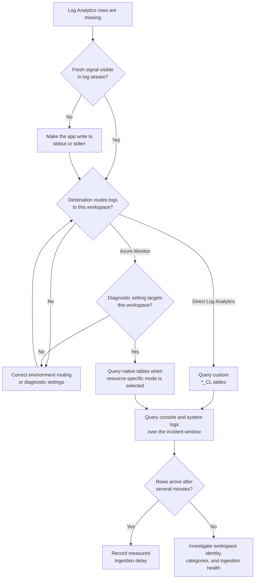

---
content_sources:
  references:
    - type: mslearn-adapted
      url: https://learn.microsoft.com/en-us/azure/container-apps/log-options
    - type: mslearn-adapted
      url: https://learn.microsoft.com/en-us/azure/container-apps/log-monitoring?tabs=bash
    - type: mslearn-adapted
      url: https://learn.microsoft.com/en-us/azure/azure-monitor/reference/tables/containerappconsolelogs
  diagrams:
    - id: log-analytics-ingestion-gap-flow
      type: flowchart
      source: mslearn-adapted
      based_on:
        - https://learn.microsoft.com/en-us/azure/container-apps/log-options
        - https://learn.microsoft.com/en-us/azure/container-apps/log-monitoring?tabs=bash
        - https://learn.microsoft.com/en-us/azure/container-apps/observability
content_validation:
  status: verified
  last_reviewed: 2026-07-18
  reviewer: ai-agent
  core_claims:
    - claim: Azure Container Apps can send console and system logs to Log Analytics for query-based troubleshooting.
      source: https://learn.microsoft.com/en-us/azure/container-apps/log-monitoring?tabs=bash
      verified: true
    - claim: Direct Log Analytics routing uses the ContainerAppConsoleLogs_CL and ContainerAppSystemLogs_CL custom tables, while Azure Monitor diagnostic settings can route logs to native resource-specific tables when that table mode is selected.
      source: https://learn.microsoft.com/en-us/azure/container-apps/log-options
      verified: true
---
# Log Analytics Ingestion Gap

Use this playbook when Azure Container Apps is healthy enough to emit logs, but the expected entries are delayed or absent in Log Analytics queries.

## Symptom

- `az containerapp logs show` or the portal log stream shows recent activity, but Log Analytics queries return no rows.
- Console or system logs appear several minutes later than operators expect.
- A recent configuration change makes it unclear whether the problem is ingestion delay, wrong destination, or a broken query.

## Possible Causes

- The environment log destination is not configured for Log Analytics.
- The query is scoped to the wrong workspace or wrong time range.
- The app emits logs, but ingestion is still within the expected short delay window.
- The workload writes little or nothing to stdout or stderr, so the table stays sparse.
- Operators are checking the wrong table for the signal they need.

## Diagnosis Steps

<!-- diagram-id: log-analytics-ingestion-gap-flow -->


*Figure: Real-time log stream evidence proves emission, while delayed Log Analytics rows prove destination ingestion; neither alone proves the other.*

1. Confirm that a fresh signal exists before you conclude ingestion failed.

    ```bash
    az containerapp logs show \
        --name "$APP_NAME" \
        --resource-group "$RG" \
        --type system \
        --tail 30
    ```

    | Command or parameter | Purpose |
    |---|---|
    | `az containerapp logs show` | Check the live log stream to confirm the container app is actually producing output before investigating the analytics pipeline. |
    | `--name` | Identify the single app to inspect, avoiding confusion with other apps in the same environment. |
    | `--resource-group` | Specify the resource group containing the container app. |
    | `--type system` | Request system-level signals (revision deployment, scaling events, platform warnings) rather than application stdout. |
    | `--tail 30` | Limit output to the most recent activity, confirming the app is currently emitting logs. |

2. Verify that the environment is configured to send logs to Log Analytics.

    ```bash
    az containerapp env show \
        --name "$ACA_ENV_NAME" \
        --resource-group "$RG" \
        --query "properties.appLogsConfiguration.destination" \
        --output tsv
    ```

    | Command or parameter | Purpose |
    |---|---|
    | `az containerapp env show` | Read the environment's `appLogsConfiguration` to confirm it is configured to send logs to Log Analytics. |
    | `--name` | Specify the Container Apps environment by name. |
    | `--resource-group` | Specify the resource group in which the workspace is deployed. |
    | `--query "properties.appLogsConfiguration.destination"` | Project the destination configuration; expected values are `log-analytics`, `azure-monitor`, or `null` (unconfigured). |
    | `--output tsv` | Return the destination as a plain string without JSON formatting. |

3. Confirm that you are querying the intended workspace.

    ```bash
    az monitor log-analytics workspace show \
        --resource-group "$RG" \
        --workspace-name "$WORKSPACE_NAME" \
        --query "{customerId:customerId,id:id}" \
        --output json
    ```

    | Command or parameter | Purpose |
    |---|---|
    | `az monitor log-analytics workspace show` | Fetch both the customer ID (data ingestion identifier) and resource ID (diagnostic settings identifier) to confirm workspace configuration. |
    | `--resource-group` | Specify the resource group where the workspace resource exists. |
    | `--workspace-name` | Name the Log Analytics workspace to inspect. |
    | `--query "{customerId:customerId,id:id}"` | Extract both the workspace customer ID (used in data ingestion) and the ARM resource ID (used in diagnostic settings); these confirm you are querying the correct destination. |
    | `--output json` | Return JSON so both ID fields are clearly distinguished. |

4. Identify the configured routing path and diagnostic-settings table mode, then query the matching table names.

    !!! note "Routing path determines the expected schema"
        Direct **Log Analytics** routing uses the custom `ContainerAppConsoleLogs_CL` and `ContainerAppSystemLogs_CL` tables documented for Container Apps log monitoring. With the **Azure Monitor** destination, a diagnostic setting completes the route; when that setting uses resource-specific tables, query the native `ContainerAppConsoleLogs` and `ContainerAppSystemLogs` schemas. Confirm the environment destination, diagnostic setting, target workspace, and table mode instead of inferring the schema from workspace age.

    **Azure Monitor diagnostic setting with resource-specific tables:**

    ```kusto
    let AppName = "ca-myapp";
    ContainerAppConsoleLogs
    | where ContainerAppName == AppName
    | where TimeGenerated > ago(30m)
    | project TimeGenerated, RevisionName, ContainerName, Log, LogLevel
    | order by TimeGenerated desc
    ```

    ```kusto
    let AppName = "ca-myapp";
    ContainerAppSystemLogs
    | where ContainerAppName == AppName
    | where TimeGenerated > ago(30m)
    | project TimeGenerated, RevisionName, ReplicaName, Reason, Log
    | order by TimeGenerated desc
    ```

    **Direct Log Analytics routing:**

    ```kusto
    let AppName = "ca-myapp";
    ContainerAppConsoleLogs_CL
    | where ContainerAppName_s == AppName
    | where TimeGenerated > ago(30m)
    | project TimeGenerated, RevisionName_s, ContainerName_s, Log_s, LogLevel_s
    | order by TimeGenerated desc
    ```

    ```kusto
    let AppName = "ca-myapp";
    ContainerAppSystemLogs_CL
    | where ContainerAppName_s == AppName
    | where TimeGenerated > ago(30m)
    | project TimeGenerated, RevisionName_s, ReplicaName_s, Reason_s, Log_s
    | order by TimeGenerated desc
    ```

5. If the schema-appropriate tables are still empty, run the same query from the CLI to remove portal scope confusion. The example below follows the direct Log Analytics route; substitute native table and column names when verifying a resource-specific diagnostic setting.

    ```bash
    az monitor log-analytics query \
        --workspace "$WORKSPACE_CUSTOMER_ID" \
        --analytics-query "ContainerAppConsoleLogs_CL | where ContainerAppName_s == '$APP_NAME' | where TimeGenerated > ago(30m) | project TimeGenerated, RevisionName_s, ContainerName_s, Log_s | take 20" \
        --output table
    ```

    | Command or parameter | Purpose |
    |---|---|
    | `az monitor log-analytics query` | Run the query outside the portal to isolate whether the issue is in the data pipeline or the portal's query/filtering logic. |
    | `--workspace` | Specify the Log Analytics workspace using the customer ID (the same identifier the environment uses). |
    | `--analytics-query` | Execute a time-scoped query over the last 30 minutes; zero rows from the CLI strongly suggests the issue is in the data ingestion path, not the portal. |
    | `--output table` | Return results in a human-readable table format suitable for quick visual inspection. |

## Resolution

1. If the environment destination is not `log-analytics`, correct the logging destination before continuing.
2. If the destination is correct, retry both system and console queries after several minutes before declaring an outage. Microsoft Learn documents a delay of several minutes, not a fixed arrival deadline; correlate repeated queries with a known fresh signal and the configured routing path.
3. If system logs arrive but console logs do not, validate that the app actually writes to stdout or stderr. Check the application code or use `az containerapp logs show --type console --tail 10` to confirm the application is producing output.
4. If both tables remain empty, verify that the selected workspace is the same one attached to the Container Apps environment by comparing the customer ID or resource ID from step 3.
5. If logs recently started flowing after a short delay, document the measured ingestion gap so future incidents are not misclassified.

## Prevention

- Standardize workspace naming and capture the workspace resource ID in the runbook used by operators.
- Keep saved KQL for both supported paths: `ContainerAppConsoleLogs_CL` and `ContainerAppSystemLogs_CL` for direct Log Analytics routing, plus native table equivalents for resource-specific diagnostic settings.
- Alert on missing log volume only after a grace period that accounts for normal ingestion delay.
- Include a known-good signal, such as revision start events, in observability validation after each environment change.

## See Also

- [Log Analytics Ingestion Gap Lab](../../lab-guides/log-analytics-ingestion-gap.md)
- [Diagnostic Settings Missing](diagnostic-settings-missing.md)
- [Observability Tracing Lab](../../lab-guides/observability-tracing.md)
- [CrashLoop OOM and Resource Pressure](../scaling-and-runtime/crashloop-oom-and-resource-pressure.md)

## Sources

- [Log storage and monitoring options in Azure Container Apps](https://learn.microsoft.com/en-us/azure/container-apps/log-options)
- [Monitor logs in Azure Container Apps with Log Analytics](https://learn.microsoft.com/en-us/azure/container-apps/log-monitoring?tabs=bash)
- [Observability in Azure Container Apps](https://learn.microsoft.com/en-us/azure/container-apps/observability)
- [ContainerAppConsoleLogs table reference](https://learn.microsoft.com/en-us/azure/azure-monitor/reference/tables/containerappconsolelogs)
