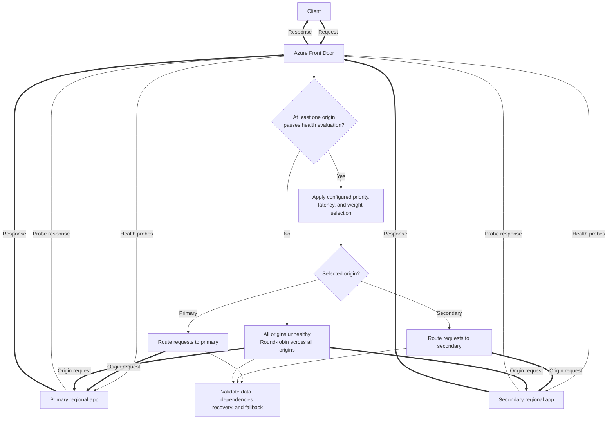

---
content_sources:
  references:
    - type: mslearn-adapted
      url: https://learn.microsoft.com/en-us/azure/reliability/reliability-container-apps
  diagrams:
    - id: multi-region-failover-flow
      type: flowchart
      source: mslearn-adapted
      based_on:
        - https://learn.microsoft.com/en-us/azure/reliability/reliability-container-apps
        - https://learn.microsoft.com/en-us/azure/frontdoor/create-front-door-cli
        - https://learn.microsoft.com/en-us/azure/frontdoor/health-probes
content_validation:
  status: verified
  last_reviewed: 2026-07-18
  reviewer: ai-agent
  core_claims:
    - claim: Azure reliability guidance for Container Apps recommends multi-region planning for higher resilience requirements.
      source: https://learn.microsoft.com/en-us/azure/reliability/reliability-container-apps
      verified: true
    - claim: Azure Front Door uses health probes to exclude unhealthy origins from normal origin selection, but if every origin fails probes it distributes traffic round-robin across all origins.
      source: https://learn.microsoft.com/en-us/azure/frontdoor/health-probes
      verified: true
---
# Multi-Region Failover

Use this playbook when traffic does not fail over away from an unhealthy Azure Container Apps region or when failback behavior is inconsistent.

## Symptom

- Users continue hitting an unhealthy regional backend.
- Azure Front Door health probes do not remove a failed origin quickly enough.
- Failover works for one path but not another because health endpoints are inconsistent.
- Active-active traffic steering is configured, but only one region appears healthy.

<!-- diagram-id: multi-region-failover-flow -->


*Figure: Health probes and client traffic are separate exchanges. Healthy origins remain eligible for configured priority, latency, and weight selection; if all origins fail probes, Front Door falls back to round-robin distribution across every origin while operators investigate both regions.*

## Possible Causes

- The health probe path does not represent real application health.
- Front Door origin group settings are too tolerant for the failure mode.
- Regional backends are not configured identically.
- Private connectivity or certificate configuration is broken in one region.
- Data, image, or secret replication is incomplete, so the secondary region is alive but not truly ready.

## Diagnosis Steps

1. Confirm both regions are deployed and individually reachable.
2. Inspect the Front Door origin group probe settings.
3. Validate that the probe path exercises a meaningful health dependency.
4. Compare app, ingress, and dependency configuration between regions.

```bash
export RG_PRIMARY="rg-myapp-primary"
export RG_SECONDARY="rg-myapp-secondary"
export APP_NAME_PRIMARY="ca-myapp-primary"
export APP_NAME_SECONDARY="ca-myapp-secondary"
export AFD_PROFILE="afd-myapp"

az afd origin-group show \
    --resource-group "$RG_PRIMARY" \
    --profile-name "$AFD_PROFILE" \
    --origin-group-name "aca-origins" \
    --output json

az containerapp show \
    --name "$APP_NAME_PRIMARY" \
    --resource-group "$RG_PRIMARY" \
    --query "properties.configuration.ingress.fqdn" \
    --output tsv

az containerapp show \
    --name "$APP_NAME_SECONDARY" \
    --resource-group "$RG_SECONDARY" \
    --query "properties.configuration.ingress.fqdn" \
    --output tsv
```

| Command or parameter | Purpose |
|---|---|
| `az afd origin-group show` | Reads the Front Door health probe configuration to verify probe interval, success criteria, and path. |
| `az containerapp show` | Reads each regional app FQDN to confirm both regions are deployed and the origin names match. |
| `--name` | Targets the primary and secondary regional apps. |
| `--origin-group-name` | Specifies the origin group (e.g., aca-origins) that groups the regional backends. |
| `--output` | Formats as JSON (probe config) or TSV (FQDN extraction). |
| `--profile-name` | Targets the Front Door profile by name. |
| `--query` | Extracts the FQDN field from the app config to match against Front Door origins. |
| `--resource-group` | Ensures queries target the correct resource groups (primary and secondary separately). |

KQL to compare regional symptoms when Log Analytics is centralized:

```kusto
ContainerAppSystemLogs_CL
| where TimeGenerated > ago(4h)
| where Log_s has_any ("Replica", "Failed", "Probe", "Revision")
| summarize Events=count() by ContainerAppName_s, Reason_s, bin(TimeGenerated, 10m)
| order by TimeGenerated asc
```

## Resolution

1. Make the health probe endpoint reflect application readiness, not just process liveness.
2. Tighten or relax Front Door probe thresholds based on the failure mode you observed.
3. Bring the secondary region to parity for images, secrets, identities, and dependencies.
4. Rehearse a controlled regional drain and confirm both failover and failback behavior.

```bash
az afd origin-group update \
    --resource-group "$RG_PRIMARY" \
    --profile-name "$AFD_PROFILE" \
    --origin-group-name "aca-origins" \
    --probe-request-type GET \
    --probe-protocol Https \
    --probe-interval-in-seconds 30 \
    --probe-path "/health" \
    --sample-size 4 \
    --successful-samples-required 3 \
    --additional-latency-in-milliseconds 50
```

| Command or parameter | Purpose |
|---|---|
| `az afd origin-group update` | Updates Front Door health probe configuration to change probe path, interval, or success threshold. |
| `--additional-latency-in-milliseconds` | Sets the extra latency tolerance before marking an origin as unhealthy (in this case, 50ms). |
| `--origin-group-name` | Targets the origin group (e.g., aca-origins) being tuned. |
| `--probe-interval-in-seconds` | Sets how often Front Door probes the origins (30 seconds in this example). |
| `--probe-path` | Sets the health endpoint path (e.g., /health) that Front Door requests. |
| `--probe-protocol` | Sets the protocol for probes (Https for encrypted health checks). |
| `--probe-request-type` | Sets the HTTP method for probes (GET in this example). |
| `--profile-name` | Targets the Front Door profile by name. |
| `--resource-group` | Ensures the update targets the primary resource group. |
| `--sample-size` | Sets how many probe attempts Front Door samples (4 in this example). |
| `--successful-samples-required` | Sets how many must pass to mark the origin healthy (3 out of 4 in this example). |

## Prevention

- Keep multi-region deployments symmetrical by design.
- Use health endpoints that check real dependencies required for safe traffic handling.
- Test failover regularly instead of waiting for a real outage.
- Document acceptable recovery time and how Front Door thresholds map to that target.

## See Also

- [Multi-Region Failover Lab](../../lab-guides/multi-region-failover.md)
- [Bad Revision Rollout and Rollback](./bad-revision-rollout-and-rollback.md)
- [Cold Start and Scale-to-Zero Lab](../../lab-guides/cold-start-scale-to-zero.md)

## Sources

- [Reliability in Azure Container Apps](https://learn.microsoft.com/en-us/azure/reliability/reliability-container-apps)
- [Create an Azure Front Door with the Azure CLI](https://learn.microsoft.com/en-us/azure/frontdoor/create-front-door-cli)
- [Health probes in Azure Front Door](https://learn.microsoft.com/en-us/azure/frontdoor/health-probes)
- [Azure Front Door CLI reference](https://learn.microsoft.com/en-us/cli/azure/afd)
