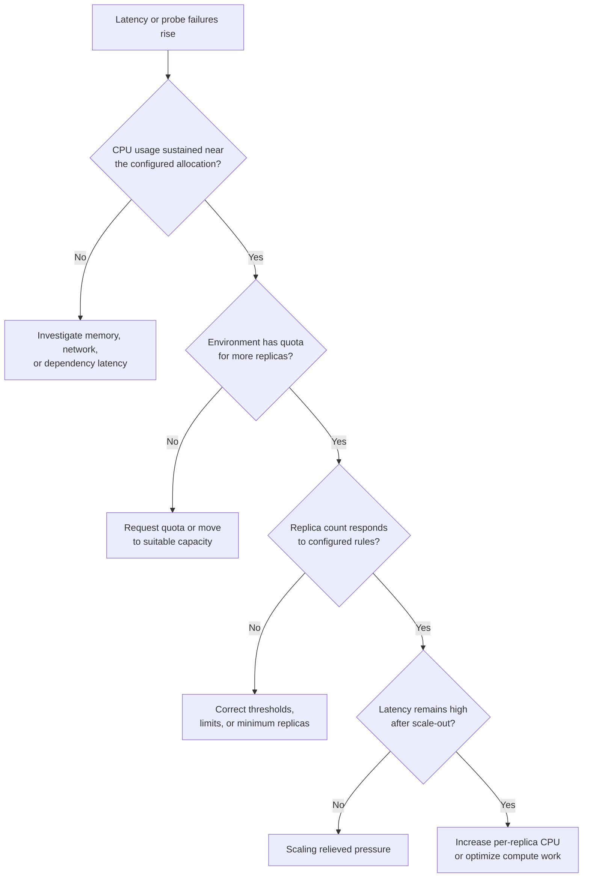

---
content_sources:
  references:
    - type: mslearn-adapted
      url: https://learn.microsoft.com/en-us/azure/container-apps/workload-profiles-overview
  diagrams:
    - id: cpu-throttling-decision-flow
      type: flowchart
      source: mslearn-adapted
      based_on:
        - https://learn.microsoft.com/en-us/azure/container-apps/workload-profiles-overview
        - https://learn.microsoft.com/en-us/azure/container-apps/quotas
        - https://learn.microsoft.com/en-us/azure/container-apps/metrics
        - https://learn.microsoft.com/en-us/azure/container-apps/scale-app
content_validation:
  status: verified
  last_reviewed: '2026-07-18'
  reviewer: ai-agent
  core_claims:
    - claim: Azure Container Apps exposes CPU-related metrics that can be queried from Azure Monitor.
      source: https://learn.microsoft.com/en-us/azure/container-apps/metrics
      verified: true
    - claim: A workload profile determines the type and amount of compute and memory resources available to container apps deployed in an Azure Container Apps environment.
      source: https://learn.microsoft.com/en-us/azure/container-apps/workload-profiles-overview
      verified: true
---
# CPU Throttling

Use this playbook when latency rises under burst traffic, startup becomes slow under load, or replicas stay healthy but CPU saturation prevents them from keeping up.

## Symptom

- Request latency climbs during bursts even though the app stays nominally available.
- Health probes begin to fail only when traffic or background work increases.
- CPU metrics stay pinned near the configured limit while replica count lags demand.
- Environment or revision events suggest quota pressure rather than an application crash.

## Possible Causes

- Per-replica CPU allocation is too small for the request burst.
- HTTP concurrency is too high, so each replica accepts more work than its CPU budget can sustain.
- Scale-out is too slow for the burst profile.
- Environment-level quota pressure reduces available headroom.
- Startup or warm-up logic competes with live traffic for the same CPU budget.

## Diagnosis Steps

<!-- diagram-id: cpu-throttling-decision-flow -->


*Figure: CPU saturation, available environment quota, and scaler response are independent checks; increasing CPU is justified only after the load remains CPU-bound per replica.*

1. Confirm the current resource envelope and scale settings.

    ```bash
    az containerapp show \
        --name "$APP_NAME" \
        --resource-group "$RG" \
        --query "{resources:properties.template.containers[0].resources,scale:properties.template.scale}" \
        --output json

    az containerapp env list-usages \
        --subscription "<subscription-id>" \
        --resource-group "$RG" \
        --name "$ACA_ENV_NAME"
    ```

    | Command or parameter | Purpose |
    |---|---|
    | `az containerapp show` | Fetches CPU and memory reservation plus scale rule thresholds to establish baseline resource constraints before diagnosing saturation. |
    | `az containerapp env list-usages` | Reports current environment compute and memory consumption to detect whether headroom for new replicas exists. |
    | `--name` | Targets the app and environment by name to prevent accidentally comparing another app's or environment's configuration. |
    | `--output` | Formats as `json` so the CPU/memory/scale fields can be parsed programmatically and compared against observed metrics. |
    | `--query` | Extracts only CPU, memory, and scale fields to reduce parsing and focus on the resources that throttle latency. |
    | `--resource-group` | Narrows both commands to the exact resource group containing the affected app and environment. |
    | `--subscription` | Specifies the subscription ID explicitly for `env list-usages` in multi-subscription scenarios. |

2. Check whether CPU usage is saturating while requests continue to rise.

    ```bash
    az monitor metrics list \
        --resource "/subscriptions/<subscription-id>/resourceGroups/$RG/providers/Microsoft.App/containerApps/$APP_NAME" \
        --metric UsageNanoCores \
        --aggregation Average \
        --offset PT1H
    ```

    | Command or parameter | Purpose |
    |---|---|
    | `az monitor metrics list` | Retrieves the time-series of CPU usage to correlate with the latency timeline and determine whether usage stays near the limit during incidents. |
    | `--aggregation` | Uses `Average` to smooth per-second CPU spikes and identify sustained throttling patterns that compress latency tails. |
    | `--metric` | Selects `UsageNanoCores` (the only CPU metric directly comparable to `--cpu` allocations) to match configuration limits against observed usage. |
    | `--resource` | Targets the exact container app by resource ID to prevent querying metrics from a similarly named app in another subscription or resource group. |
    | `--offset` | Sets a `PT1H` lookback from the current time to capture the recent incident window. |

3. Correlate request pressure, replica count, and throttling symptoms in Log Analytics.

    ```kusto
    let AppName = "ca-myapp";
    ContainerAppSystemLogs_CL
    | where ContainerAppName_s == AppName
    | where TimeGenerated > ago(1h)
    | where Reason_s has_any ("ProbeFailed", "ReplicaStarted", "ReplicaReady")
       or Log_s has_any ("timeout", "probe", "throttle", "cpu")
    | project TimeGenerated, RevisionName_s, ReplicaName_s, Reason_s, Log_s
    | order by TimeGenerated desc
    ```

4. Inspect whether the scale rule is allowing too much work per replica before additional replicas appear.

    ```bash
    az containerapp show \
        --name "$APP_NAME" \
        --resource-group "$RG" \
        --query "properties.template.scale.rules" \
        --output json
    ```

    | Command or parameter | Purpose |
    |---|---|
    | `az containerapp show` | Reads the configured scale rules to confirm thresholds (CPU % or requests/sec) that trigger replica additions. |
    | `--name` | Targets the app by name to retrieve its specific scale rule configuration rather than a default or another app's rules. |
    | `--output` | Formats as `json` so threshold values can be extracted and compared against the CPU metric average observed during the latency spike. |
    | `--query` | Extracts only `scale.rules` to isolate the trigger conditions from the full app definition. |
    | `--resource-group` | Narrows the query to the exact resource group to prevent cross-group configuration confusion. |

## Resolution

1. Increase per-replica CPU when each request genuinely needs more compute.

    ```bash
    az containerapp update \
        --name "$APP_NAME" \
        --resource-group "$RG" \
        --cpu 1.0 \
        --memory 2.0Gi
    ```

    | Command or parameter | Purpose |
    |---|---|
    | `az containerapp update` | Applies the CPU and memory change across all replicas, moving to the next supported CPU tier to reduce throttling. |
    | `--cpu` | Sets `1.0` core; choose the minimum CPU tier above your observed usage + 20% headroom to absorb request spikes without saturation. |
    | `--memory` | Sets `2.0Gi` proportional to the CPU increase (Azure Container Apps enforces specific CPU:memory ratios; 1.0 CPU requires at least 2.0Gi). |
    | `--name` | Targets the app by name to ensure the CPU increase applies to the correct revision and not a similarly named app. |
    | `--resource-group` | Restricts the update to the exact resource group. |

2. Reduce HTTP concurrency or lower scale thresholds so new replicas arrive before each replica is overloaded.
3. Increase `minReplicas` for known burst windows to avoid slow scale-out.
4. Move the workload to a workload profile with more predictable CPU headroom if burst traffic is normal.
5. If startup is CPU-heavy, separate warm-up work from live request handling or extend startup timing appropriately.

## Prevention

- Baseline `UsageNanoCores`, latency, and replica count together, not in isolation.
- Keep load-test evidence for the chosen CPU setting and scale thresholds.
- Alert on sustained high CPU plus rising latency, not on CPU alone.
- Avoid very high HTTP concurrency on CPU-intensive endpoints.
- Revisit workload profile and quota assumptions before major traffic events.

## See Also

- [Memory Leak OOMKilled](memory-leak-oomkilled.md)
- [Replica Load Imbalance](replica-load-imbalance.md)
- [Workload Profile Mismatch](../cost-and-quota/workload-profile-mismatch.md)
- [Subscription Quota Exceeded](../cost-and-quota/subscription-quota-exceeded.md)

## Sources

- [Workload profiles in Azure Container Apps](https://learn.microsoft.com/en-us/azure/container-apps/workload-profiles-overview)
- [Quotas for Azure Container Apps](https://learn.microsoft.com/en-us/azure/container-apps/quotas)
- [Metrics in Azure Container Apps](https://learn.microsoft.com/en-us/azure/container-apps/metrics)
- [Scaling in Azure Container Apps](https://learn.microsoft.com/en-us/azure/container-apps/scale-app)
