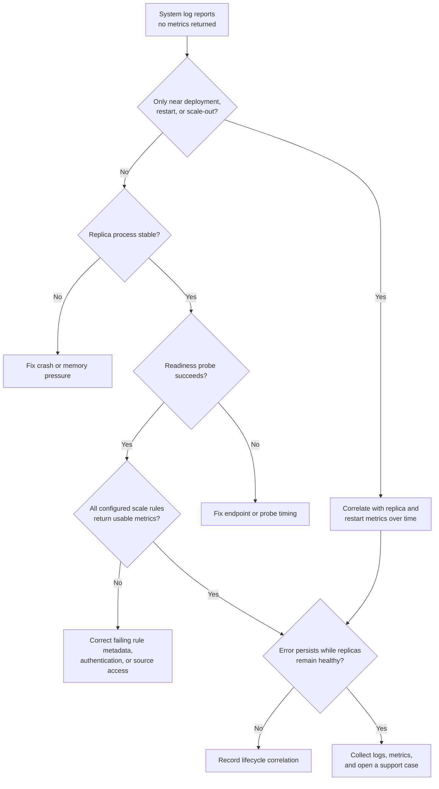

---
content_sources:
  diagrams:
    - id: troubleshooting-decision-flow
      type: flowchart
      source: self-generated
      justification: Synthesizes Container Apps scale-rule, replica-health, and Azure Monitor evidence into a diagnostic decision flow.
      based_on:
        - https://learn.microsoft.com/en-us/azure/container-apps/scale-app
        - https://learn.microsoft.com/en-us/azure/container-apps/metrics
        - https://learn.microsoft.com/en-us/azure/container-apps/health-probes
content_validation:
  status: verified
  last_reviewed: 2026-11-08
  reviewer: agent
  core_claims:
    - claim: Azure Container Apps supports CPU and memory scale rules and uses KEDA for event-driven scaling.
      source: https://learn.microsoft.com/en-us/azure/container-apps/scale-app
      verified: true
    - claim: Azure Container Apps exposes replica count and restart count metrics through Azure Monitor for correlation with scaler errors.
      source: https://learn.microsoft.com/en-us/azure/container-apps/metrics
      verified: true
    - claim: Startup, readiness, and liveness probes provide distinct health signals for Container Apps replicas.
      source: https://learn.microsoft.com/en-us/azure/container-apps/health-probes
      verified: true
---
# KEDA "No Metrics Returned from Resource Metrics API"

## 1. Summary

### Symptom

Container Apps system logs (`ContainerAppSystemLogs_CL`) show one or more
of these messages:

```text
failed to get memory usage: unable to get metrics for resource memory: no metrics returned from resource metrics API
invalid metrics (1 invalid out of 5), first error is: failed to get <app> container metric value: failed to get cpu usage: unable to get metrics for resource cpu: no metrics returned from resource metrics API
scaler memory info: The 'type' setting is DEPRECATED and will be removed in v2.18 - Use 'metricType' instead.
```

!!! tip "TL;DR"
    The first two messages are **transient** and occur when the Kubernetes
    Metrics Server has no data for a container — typically during startup,
    restart, or deployment. By themselves, these messages do not prove
    a broken scaler. The third
    message is a **configuration deprecation warning** unrelated to
    runtime health.

### When to use this playbook

Use this playbook when:

- System logs contain `no metrics returned from resource metrics API` messages
- CPU or memory scaler behavior differs from Azure Portal metric charts
- You need to determine if metric errors are transient (expected) or persistent (action needed)
- The app recently deployed, restarted, crashed, or scaled from zero

### When not to use this playbook

Do not start from this playbook when:

- HTTP scaling is not triggering — see [HTTP Scaling Not Triggering](./http-scaling-not-triggering.md)
- Memory percentage disagrees with KEDA utilization — see [Memory Percentage vs KEDA Utilization](./memory-percentage-vs-keda-utilization.md)
- Custom or event scalers fail — see [Event Scaler Mismatch](./event-scaler-mismatch.md)
- The issue is HTTP 5xx without scaling symptoms
- The container is OOMKilled with no scaling rule configured

### Why these messages appear

KEDA's CPU and memory scalers delegate to the standard Kubernetes HPA,
which queries the **Resource Metrics API** (backed by the metrics-server
or kubelet summary API) for per-container utilization. The Metrics Server
can only return data for containers that:

1. Are **Running** and **Ready** (passed readiness probe).
2. Have been running long enough for the kubelet to collect at least one
   metrics sample. In the linked Korea Central lab run on 2026-06-05, that
   initial sample took about 60 seconds; treat this as environment-specific
   evidence, not a platform-wide timing guarantee.

When either condition is not met, the Metrics API returns an empty
response, and the HPA controller logs:

```
unable to get metrics for resource <cpu|memory>: no metrics returned from resource metrics API
```

If the ScaledObject has **multiple triggers** and only some fail, the HPA
reports `invalid metrics (N invalid out of M)`.

### Troubleshooting decision flow

<!-- diagram-id: troubleshooting-decision-flow -->


*Figure: A log message alone does not prove a scaler defect; replica health, readiness, and each scale rule provide the evidence needed to classify it.*

## 2. Common Scenarios

| Scenario | Duration | Impact on scaling | Action required |
|---|---|---|---|
| **New revision deployment** | 30-60s per replica in the Korea Central lab | None — transient | No |
| **Scale-from-zero cold start** | 60-180s in the Korea Central lab | First scaling decision delayed | Set `minReplicas >= 1` if latency-sensitive |
| **Container crash/restart** | Repeats each cycle | Scaling decisions skip affected replica | Fix the crash |
| **OOMKill** | Brief per kill | Similar to crash | Right-size memory or fix leak |
| **Platform node maintenance** | 30-120s in the Korea Central lab | Transparent if multiple replicas | No |
| **Readiness probe too aggressive** | Persistent if probe keeps failing | Replica stays Not Ready, typically does not report metrics | Tune probe timing |

!!! example "Lab observation"
    In the [KEDA No Metrics Returned Lab](../../lab-guides/keda-no-metrics-returned.md) (Korea Central, 2026-06-05), even a healthy, instantly-starting container produced "no metrics returned" logs for ~60 seconds after deployment. This should be treated as a lab observation in a specific environment, not a universal platform guarantee.

## 3. Competing Hypotheses

| Hypothesis | Evidence For | Evidence Against |
|---|---|---|
| **H1: Expected lifecycle gap** | Logs appear only during deploy/restart windows; `RestartCount` is stable; scaling works normally otherwise | Logs persist beyond 10 minutes with no deploy activity |
| **H2: CrashLoopBackOff** | `RestartCount` metric rises steadily; console logs show application errors or exit codes | `RestartCount` is flat; container runs stably |
| **H3: Probe misconfiguration** | Replica stays in Not Ready state; `FailedHealthProbe` events in system logs | Probes pass; replica becomes Ready within expected time |
| **H4: One scaler blocking others** | `invalid metrics (N invalid out of M)` where N < M; only specific trigger fails | All metrics fail equally |
| **H5: Platform issue** | Logs persist with healthy container, correct probes, single trigger | Any of the above explains it |

## 4. What to Check First

### System logs query (KQL)

```bash
# Use the Log Analytics workspace customerId (GUID), not the Azure resource ID
WORKSPACE_ID="<log-analytics-workspace-customer-id>"

az monitor log-analytics query \
  --workspace "$WORKSPACE_ID" \
  --analytics-query "
    ContainerAppSystemLogs_CL
    | where ContainerAppName_s == '<app-name>'
    | where Log_s has_any ('no metrics returned', 'invalid metrics', 'failed to get')
    | project TimeGenerated, Log_s
    | order by TimeGenerated desc
    | take 30
  " \
  --output table
```

| Command or parameter | Purpose |
|---|---|
| `az monitor log-analytics query` | Searches system logs for scaler errors with timestamps, enabling correlation between metric gaps and container lifecycle events (deployment, restart, readiness probe transitions). |
| `--analytics-query` | Filters to the target app and error patterns (`no metrics returned`, `invalid metrics`, `failed to get`); orders by timestamp (newest first) to identify whether errors cluster during known restarts or persist unexpectedly. |
| `--workspace` | Targets the Log Analytics workspace using the customer ID (not resource ID), necessary because system logs are written by the managed platform agent. |
| `--output table` | Human-readable format for terminal inspection of error timestamps and progression. |

### Restart count correlation

```bash
APP_ID="$(az containerapp show --name '<app-name>' --resource-group '<rg>' --query id --output tsv)"

az monitor metrics list \
  --resource "$APP_ID" --metric "RestartCount" \
  --aggregation Total --interval PT5M --offset PT1H \
  --output table
```

| Command or parameter | Purpose |
|---|---|
| `az containerapp show` | Retrieves the resource ID of the target app, required as input to `az monitor metrics list`. |
| `az monitor metrics list` | Enumerates restart count metrics over a time window, showing whether restarts align with the timestamps of `no metrics returned` log entries. |
| `--name` | Selects `<app-name>` for the resource-ID lookup performed by `az containerapp show`. |
| `--resource-group` | Locates `<app-name>` within `<rg>` before its ID is passed to the metrics query. |
| `--query` | Extracts the app's `id` property for assignment to `APP_ID`. |
| `--output` | Emits the app ID as unquoted TSV for `APP_ID`, then renders restart-count metric points as a readable table. |
| `--resource` | Sends `az monitor metrics list` to the Container App identified by `$APP_ID`. |
| `--metric` | Requests `RestartCount`, the series used to correlate restarts with scaler-error timestamps. |
| `--aggregation` | Totals restart events inside each metric bucket rather than averaging their count. |
| `--interval` | Divides the restart series into `PT5M` buckets for comparison with the system-log timeline. |
| `--offset` | Restricts the metric evidence to the preceding `PT1H`, covering the recent failure window. |

If restart timestamps align with "no metrics" log timestamps, the cause
is container lifecycle, likely not a scaler defect.

### Console logs for crash evidence

```bash
az containerapp logs show \
  --name "<app-name>" --resource-group "<rg>" \
  --type console --follow false --tail 30
```

| Command or parameter | Purpose |
|---|---|
| `az containerapp logs show` | Retrieves recent application stdout and stderr; stack traces, exit codes, or out-of-memory messages explain why the metrics API had no data (container was not running or was crashing). |
| `--type` | Selects `console` output so stack traces and process exits come from application stdout and stderr. |
| `--follow` | Uses `false` to return the current crash evidence instead of holding an interactive stream open. |
| `--tail` | Limits this check to the latest `30` console lines where the terminating error is most likely visible. |
| `--name` | Targets the app by name. |
| `--resource-group` | Restricts to the resource group. |

Look for stack traces, `exit(1)`, or OOMKilled messages.

### DEPRECATED warning

The `type` metadata field warning:

```text
scaler memory info: The 'type' setting is DEPRECATED and will be removed in v2.18 - Use 'metricType' instead.
```

This appears because the scale rule uses `--scale-rule-metadata "type=Utilization"`.
KEDA v2.7+ deprecated `metadata.type` in favor of the trigger-level `metricType`
field. The `type` field was removed in KEDA v2.18.

In Azure Container Apps, the KEDA version is managed by the platform. Whether
`metricType` is exposed depends on the Container Apps API version.
**This warning is cosmetic and should not affect scaling behavior** on current
platform versions.

## 5. Resolution

| Hypothesis | Action |
|---|---|
| **H1** | No action. These are expected transient logs during container lifecycle transitions. |
| **H2** | Fix the application crash. Check console logs for the root cause. Once the container runs stably, the metric errors will stop. |
| **H3** | Adjust `startupProbe` and `readinessProbe` timings to match the actual container startup duration. Increase `initialDelaySeconds` or `failureThreshold` if the container needs more time. |
| **H4** | Review all scale rule triggers. An unreachable external scaler or misconfigured trigger can cause `invalid metrics` for other scalers in the same ScaledObject. |
| **H5** | Open a support case with timestamps, the scale rule definition, and relevant `ContainerAppSystemLogs_CL` excerpts. |

## 6. Prevention

- Set `minReplicas >= 1` for latency-sensitive workloads to avoid
  cold-start metrics gaps from scale-to-zero.
- Configure `startupProbe` with appropriate `initialDelaySeconds` and
  `failureThreshold` so the container has time to initialize before
  being marked unhealthy.
- Fix application crashes that cause CrashLoopBackOff — each restart
  creates a new metrics gap window.
- These logs **cannot currently be suppressed or filtered** — they are internal
  KEDA/HPA controller logs emitted by the platform.

## See Also

- Lab guide: [KEDA No Metrics Returned Lab](../../lab-guides/keda-no-metrics-returned.md)
- Playbook: [Memory Scale Rule Not Triggering Despite High Memory Percentage](./memory-percentage-vs-keda-utilization.md)
- Playbook: [HTTP Scaling Not Triggering](./http-scaling-not-triggering.md)
- Platform: [CPU and Memory Scaler](../../../platform/scaling/cpu-memory-scaler.md)

## Sources

- [Scaling in Azure Container Apps](https://learn.microsoft.com/en-us/azure/container-apps/scale-app)
- [Metrics in Azure Container Apps](https://learn.microsoft.com/en-us/azure/container-apps/metrics)
- [Health probes in Azure Container Apps](https://learn.microsoft.com/en-us/azure/container-apps/health-probes)

- [Set scaling rules - Azure Container Apps](https://learn.microsoft.com/en-us/azure/container-apps/scale-app)
- [KEDA memory scaler](https://keda.sh/docs/latest/scalers/memory/)
- [Horizontal Pod Autoscaler algorithm details - Kubernetes](https://kubernetes.io/docs/tasks/run-application/horizontal-pod-autoscale/#algorithm-details)
- [HPA with container metrics fails when pod is not ready - kubernetes#127169](https://github.com/kubernetes/kubernetes/issues/127169)
- [Deprecating parameter 'type' in CPU/Memory scaler - kedacore/keda#6348](https://github.com/kedacore/keda/discussions/6348)
- [Troubleshooting HPA metric retrieval - SigNoz](https://signoz.io/guides/kubernetes-hpa-unable-to-get-metrics-for-resource-memory-no-metrics-returned-from-resource-metrics-api/)
