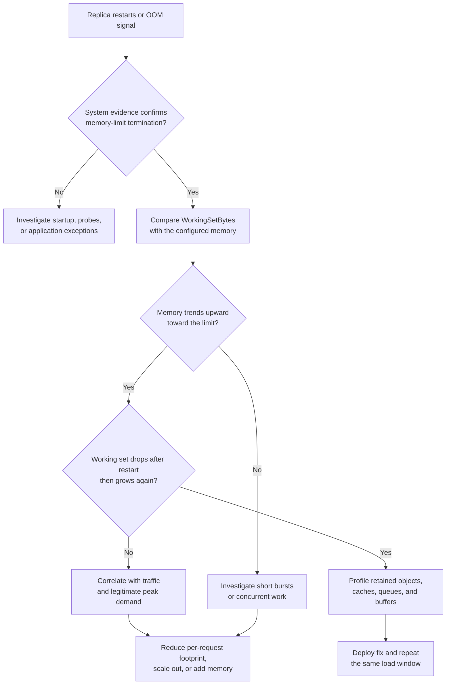

---
content_sources:
  references:
    - type: mslearn-adapted
      url: https://learn.microsoft.com/en-us/azure/container-apps/troubleshoot-container-start-failures
  diagrams:
    - id: memory-leak-oomkilled-decision-flow
      type: flowchart
      source: mslearn-adapted
      based_on:
        - https://learn.microsoft.com/en-us/azure/container-apps/troubleshoot-container-start-failures
        - https://learn.microsoft.com/en-us/azure/container-apps/containers
        - https://learn.microsoft.com/en-us/azure/container-apps/metrics
        - https://learn.microsoft.com/en-us/azure/reliability/reliability-container-apps
content_validation:
  status: verified
  last_reviewed: 2026-07-18
  reviewer: ai-agent
  core_claims:
    - claim: Azure Container Apps can terminate a container that exceeds its memory limit.
      source: https://learn.microsoft.com/en-us/azure/container-apps/troubleshoot-container-start-failures
      verified: true
    - claim: Azure Monitor exposes memory-related metrics for Azure Container Apps.
      source: https://learn.microsoft.com/en-us/azure/container-apps/metrics
      verified: true
---
# Memory Leak OOMKilled

Use this playbook when replicas restart with `OOMKilled`, exit code `137`, or repeated memory-pressure symptoms that briefly improve after a restart and then return.

## Symptom

- Replicas restart repeatedly after serving traffic for a period of time.
- System logs or revision events contain `OOMKilled`, `Killed`, or abrupt termination signals.
- Working set memory climbs until it approaches the configured limit.
- Increasing traffic or long-lived sessions accelerates the restart pattern.

## Possible Causes

- Application memory leak in caches, queues, or retained objects.
- Legitimate peak memory demand that exceeds the replica limit.
- Memory-heavy startup or background jobs sharing the same replica budget.
- Missing backpressure, causing unbounded in-memory buffering.
- Too few replicas, forcing each replica to hold too much state.

## Diagnosis Steps

<!-- diagram-id: memory-leak-oomkilled-decision-flow -->


*Figure: Repeated growth after each restart strongly supports retained-memory behavior, while demand-correlated peaks call for capacity and workload analysis.*

1. Confirm the configured memory limit and the latest replica restart pattern.

    ```bash
    az containerapp show \
        --name "$APP_NAME" \
        --resource-group "$RG" \
        --query "properties.template.containers[0].resources" \
        --output json

    az containerapp replica list \
        --name "$APP_NAME" \
        --resource-group "$RG" \
        --output table
    ```

    | Command or parameter | Purpose |
    |---|---|
    | `az containerapp show` | Retrieves memory and CPU limits configured for the target container, establishing the thresholds against which the observed `WorkingSetBytes` metric will be compared. |
    | `az containerapp replica list` | Lists current and past replica instances with their restart counts and states, showing the timeline and frequency of OOM terminations. |
    | `--query "properties.template.containers[0].resources"` | Extracts only the resource limits (memory and CPU), filtering out deployment metadata. |
    | `--output` | Uses `json` for precise resource-limit values and `table` for human-readable replica state and restart history. |
    | `--name` | Selects the app whose resource ceiling and replica history establish the OOM baseline. |
    | `--resource-group` | Scopes resource and replica evidence to the deployment that experienced OOM kills. |

2. Pull memory metrics for the incident window.

    ```bash
    az monitor metrics list \
        --resource "/subscriptions/<subscription-id>/resourceGroups/$RG/providers/Microsoft.App/containerApps/$APP_NAME" \
        --metric WorkingSetBytes \
        --aggregation Average \
        --offset PT1H
    ```

    | Command or parameter | Purpose |
    |---|---|
    | `az monitor metrics list` | Retrieves `WorkingSetBytes` samples from the incident window, showing whether memory usage trends upward toward the limit (leak signature) or spikes briefly and drops (peak-demand signature). |
    | `--metric WorkingSetBytes` | Targets working set memory (resident + dirty pages), the metric used by the kernel OOM killer to enforce limits. |
    | `--aggregation Average` | Smooths samples into per-minute (or per-interval) average, making trends visible. |
    | `--offset PT1H` | Looks back 1 hour from the current time; adjust if incidents are older or span a longer window. |
    | `--resource` | Specifies the container app resource using its full resource ID. |

3. Collect system and console logs to distinguish hard OOM from application exceptions.

    ```kusto
    let AppName = "ca-myapp";
    ContainerAppSystemLogs_CL
    | where ContainerAppName_s == AppName
    | where TimeGenerated > ago(6h)
    | where Reason_s has_any ("OOMKilled", "ContainerTerminated", "BackOff")
       or Log_s has_any ("OOM", "137", "Killed", "memory")
    | project TimeGenerated, RevisionName_s, ReplicaName_s, Reason_s, Log_s
    | order by TimeGenerated desc
    ```

    ```bash
    az containerapp logs show \
        --name "$APP_NAME" \
        --resource-group "$RG" \
        --type console \
        --tail 200
    ```

    | Command or parameter | Purpose |
    |---|---|
    | `az containerapp logs show` | Retrieves application stdout and stderr; OOM messages, heap allocation failures, or rising-memory debug logs from the app distinguish application leaks from kernel-enforced termination. |
    | `--type console` | Selects application logs (stdout/stderr), not platform system logs. |
    | `--tail 200` | Captures enough lines to see leading-up and post-termination patterns. |
    | `--name` | Names the app whose console output may reveal allocation failures. |
    | `--resource-group` | Reads console records from the resource group containing the failing revision. |

4. Verify whether scale configuration forces too much work into each replica.

    ```bash
    az containerapp show \
        --name "$APP_NAME" \
        --resource-group "$RG" \
        --query "properties.template.scale" \
        --output json
    ```

    | Command or parameter | Purpose |
    |---|---|
    | `az containerapp show` | Retrieves the scale rules (`minReplicas`, `maxReplicas`, CPU/memory triggers), showing whether `minReplicas` is too low (forcing concentration of load) or whether scale rules are misconfigured to under-provision replicas. |
    | `--query "properties.template.scale"` | Extracts only the scale configuration. |
    | `--output json` | Structured output for reading replica and trigger settings. |
    | `--name` | Points the scale-configuration read at the memory-pressured workload. |
    | `--resource-group` | Retrieves scaling settings from the affected app group. |

## Resolution

1. Fix the leak or unbounded in-memory behavior in the application first.
2. Increase memory only as a mitigation or to buy investigation time.

    ```bash
    az containerapp update \
        --name "$APP_NAME" \
        --resource-group "$RG" \
        --memory 2.0Gi \
        --cpu 1.0
    ```

    | Command or parameter | Purpose |
    |---|---|
    | `az containerapp update` | Applies memory and CPU changes; used to test whether increasing memory buys time for leak investigation or merely delays restarts. |
    | `--memory 2.0Gi` | Increases the per-replica memory limit to 2 GiB; adjust based on the leak growth rate and desired investigation window. |
    | `--cpu 1.0` | Sets CPU to match the memory increase (Azure Container Apps scales CPU and memory in fixed ratios). |
    | `--name` | Chooses the app that receives the temporary memory and CPU increase. |
    | `--resource-group` | Applies the resource increase only to the intended deployment. |

3. Scale out earlier so each replica handles less concurrent state.
4. Add or tune readiness and liveness probes so restart behavior is easier to interpret.
5. Capture heap dumps, profiles, or allocation traces in a non-production reproduction environment.

## Prevention

- Track memory growth over long test runs, not only short smoke tests.
- Avoid unbounded caches, queues, and per-request object retention.
- Set alerts on rising `WorkingSetBytes` plus restart count.
- Load-test with realistic payload sizes and concurrency.
- Keep memory budgets documented per revision and revisit them after dependency changes.

## See Also

- [CrashLoop OOM and Resource Pressure](crashloop-oom-and-resource-pressure.md)
- [CPU Throttling](cpu-throttling.md)
- [Replica Load Imbalance](replica-load-imbalance.md)

## Sources

- [Troubleshoot container start failures in Azure Container Apps](https://learn.microsoft.com/en-us/azure/container-apps/troubleshoot-container-start-failures)
- [Containers in Azure Container Apps](https://learn.microsoft.com/en-us/azure/container-apps/containers)
- [Metrics in Azure Container Apps](https://learn.microsoft.com/en-us/azure/container-apps/metrics)
- [Reliability in Azure Container Apps](https://learn.microsoft.com/en-us/azure/reliability/reliability-container-apps)
