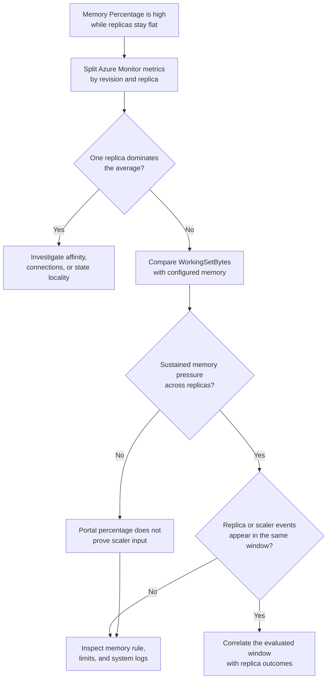

---
content_sources:
  diagrams:
    - id: troubleshooting-decision-flow
      type: flowchart
      source: self-generated
      justification: Synthesizes the metric-source-mismatch diagnostic flow from Azure Container Apps scaling and metrics documentation.
      based_on:
        - https://learn.microsoft.com/en-us/azure/container-apps/scale-app
        - https://learn.microsoft.com/en-us/azure/container-apps/metrics
content_validation:
  status: verified
  last_reviewed: 2026-11-08
  reviewer: agent
  core_claims:
    - claim: Azure Container Apps uses KEDA for event-driven scaling and supports memory-based scale rules.
      source: https://learn.microsoft.com/en-us/azure/container-apps/scale-app
      verified: true
    - claim: The Azure Monitor `Memory Percentage (Preview)` metric reports memory use as a percentage of the configured memory limit.
      source: https://learn.microsoft.com/en-us/azure/container-apps/metrics
      verified: true
    - claim: Azure Monitor exposes `Working Set Bytes` and `Memory Percentage (Preview)` metrics for Container Apps.
      source: https://learn.microsoft.com/en-us/azure/container-apps/metrics
      verified: true
---
# Memory Scale Rule Not Triggering Despite High Memory Percentage

## 1. Summary

### Symptom

The Azure Portal metric chart for a Container Apps revision shows
`Memory Percentage (Preview)` sustaining 60-70% for tens of minutes, while a
memory scale rule configured with `Utilization=50` does not increase
replicas above `minReplicas`. The customer concludes "the memory scale rule
is broken".

!!! tip "TL;DR"
    The Portal `Memory Percentage (Preview)` chart reports memory use as a
    percentage of the configured memory limit; it does not identify the value
    used in a particular scale evaluation. Use per-replica splitting, replica
    outcomes, and the HPA `ceil` formula to investigate scaling behavior.

### Why this scenario is confusing

There are **two independent contributors** to the same surface symptom, and
they are easy to confuse:

1. **HPA ceiling math.** KEDA uses the standard Kubernetes HPA formula
   `desiredReplicas = ceil(currentReplicas * currentMetric / targetMetric)`.
   With `currentReplicas = 2` and `targetMetric = 50`, the formula returns
   `2` for any per-replica metric value at or below `50` and only rounds
   up to `3` once the per-replica value strictly exceeds `50`. A 70%
   Portal reading does not by itself say what KEDA sees per replica.
2. **Metric interpretation mismatch.** Azure Monitor defines `Memory
   Percentage (Preview)` as a percentage of the configured memory limit and
   reports `Working Set Bytes` separately. The documented Container Apps
   metrics do not identify the value used in an individual scale evaluation,
   so a high chart value alone does not prove a scaler failure.

Treat the Portal chart as resource-consumption evidence, not as a direct trace
of the scaler's evaluated value.

### What to look at for which question

| Question you are answering | Trust this signal | Why |
|---|---|---|
| "How much of the configured memory limit does Azure Monitor report?" | Portal `MemoryPercentage` (Avg/Max) at the revision level | Microsoft Learn defines the metric as percentage of the memory limit. |
| "Why did (or didn't) the memory scale rule fire?" | Portal `MemoryPercentage` **split by Replica** + HPA `ceil` math + replica outcomes and system logs | The chart shows resource consumption but does not identify the value used in a particular scale evaluation. |
| "How much memory do my replicas actually consume for capacity planning?" | `WorkingSetBytes` per replica trend, alongside the configured memory size | Bytes are unambiguous and independent of which percentage formula a tool uses. |
| "What did the scaler decide, and when?" | Activity Log + `ContainerAppSystemLogs_CL` (when present), reconciled against the `Replicas` metric timeline | Portal Metrics shows replica outcomes and raw resource counters; it does not expose KEDA's internal evaluated value or the HPA `desiredReplicas` calculation. |

### Troubleshooting decision flow

<!-- diagram-id: troubleshooting-decision-flow -->


*Figure: Azure Monitor memory charts describe resource consumption; they do not expose the scaler's internal evaluated value, so replica and system evidence must complete the diagnosis.*

## 2. Common Misreadings

- "Portal shows 70%, so the scaler must have evaluated 70%." Microsoft Learn
  defines the Portal metric as a percentage of the configured memory limit,
  but does not document it as a trace of an individual scale evaluation. Use
  the chart as consumption evidence and confirm scaler behavior from replica
  outcomes and system logs.
- "Any value above the target should scale out." The HPA formula divides
  by `targetMetric` and multiplies by `currentReplicas` before rounding up.
  With two replicas at target 50, the per-replica average has to exceed
  ~50% (i.e., produce `ceil(2 * 51/50) = 3`) before scale-out occurs.
- "KEDA is broken if it does not react to a single spike." Container Apps
  evaluates scaling rules on a configurable polling interval whose default is
  30 seconds. The default 300-second cooldown applies only when scaling from
  the final replica to zero; it does not delay removal of intermediate
  replicas.
- "The chart average reflects each replica." It does not unless you apply
  splitting. A two-replica app with one heavy and one idle replica shows
  the mean, not the per-replica peak.

## 3. Competing Hypotheses

| Hypothesis | Evidence For | Evidence Against |
|---|---|---|
| **H1: HPA ceiling math** | Per-replica memory hovers just below or around the target; `ceil(N × M / target) = N` | Per-replica memory is well above target (e.g., > 60% with target 50) |
| **H2: Customer missed the event** | Replica count briefly rose and returned to a nonzero minimum outside the observed chart window | Replica count never increased during the window |
| **H3: Workload memory composition differs from the chart assumption** | `memory.stat` shows a large file-memory component and replica outcomes do not track the chart average | `memory.stat` is stable and replica outcomes track the per-replica chart |
| **H4: Real scaler problem** | KEDA logs report errors; ScaledObject is in `Unknown` state; multiple rules conflict | KEDA logs show normal polling; the rule's `type=Utilization` is set and `value` matches expectation |

## 4. What to Check First

### Per-replica metric splitting

In the Azure Portal, open the Container App's `Memory Percentage` chart and
apply **Apply splitting -> Replica**. If one replica is far above the others,
the aggregate chart can hide that imbalance. This split remains Azure Monitor
consumption evidence; it does not expose the scaler's evaluated input.

### HPA ceiling math (quick calculator)

```bash
TARGET=50
CURRENT_REPLICAS=2
CURRENT_METRIC=40      # observed average per-replica utilization
python3 -c "import math; print(math.ceil($CURRENT_REPLICAS * $CURRENT_METRIC / $TARGET))"
```

If the printed value equals `currentReplicas`, no scale-out is expected.

### cgroup memory composition (anon vs file)

```bash
APP_NAME="ca-myapp"
RG="rg-myapp"
ACTIVE_REV="$(az containerapp revision list --name "$APP_NAME" --resource-group "$RG" \
  --query '[?properties.active]|[0].name' --output tsv)"
REPLICA="$(az containerapp replica list --name "$APP_NAME" --resource-group "$RG" \
  --revision "$ACTIVE_REV" --query '[0].name' --output tsv)"

az containerapp exec --name "$APP_NAME" --resource-group "$RG" \
  --replica "$REPLICA" --container "$APP_NAME" \
  --command "/bin/sh -c '(cat /sys/fs/cgroup/memory.stat 2>/dev/null || cat /sys/fs/cgroup/memory/memory.stat) | head -10'"
```

| Command or parameter | Purpose |
| --- | --- |
| `az containerapp revision list` | Retrieves the active revision to ensure the cgroup memory sample is from the revision currently serving traffic, not a historical or inactive revision. |
| `--name` | Identifies the target app by name; used consistently across revision, replica, and exec commands to keep the evidence tied to the affected workload. |
| `--output` | Returns both selected names as unquoted TSV so the shell can assign them directly to `ACTIVE_REV` and `REPLICA`. |
| `--query` | Selects `[?properties.active]\|[0].name` for `ACTIVE_REV`, then `[0].name` from that revision's replica list for `REPLICA`. |
| `--resource-group` | Scopes all operations to the target resource group, preventing samples from a same-named app in a different group or subscription. |
| `az containerapp replica list` | Enumerates replicas within the active revision to select the runtime instance from which the cgroup memory sample will be collected. |
| `--revision` | Restricts replica enumeration to the active revision, ensuring the sample is from the version currently serving workload traffic. |
| `az containerapp exec` | Executes an in-container command to read live cgroup memory-stat fields, capturing the current memory composition (anonymous vs file-backed) at the moment of execution. |
| `--replica` | Directs the exec command to the specific replica selected by the previous commands, keeping the memory sample tied to a known instance. |
| `--container` | Targets the named app container (not a sidecar), ensuring the memory stats are from the primary workload process. |
| `--command` | Runs the supplied `/bin/sh -c` expression, reading the cgroup v2 memory-stat path first and falling back to the cgroup v1 path before showing ten fields. |

The path varies by cgroup version: cgroup v2 exposes
`/sys/fs/cgroup/memory.stat`; cgroup v1 exposes
`/sys/fs/cgroup/memory/memory.stat`. The field names also differ — cgroup
v1 uses `rss` / `cache`, while cgroup v2 uses `anon` / `file` (and splits
`file` further into `inactive_file` / `active_file`). Treat `rss` ≈ `anon`
and `cache` ≈ `file` when comparing the two layouts.

If `file` is much larger than `anon` (or `cache` is much larger than `rss` on
v1), record that composition as workload evidence. Do not infer the scaler's
input from this comparison alone; correlate it with per-replica metrics,
replica outcomes, and system logs.

| Field in `memory.stat` | Meaning | Inflates Portal? | Likely impact on KEDA input |
|---|---|---|---|
| `anon` | Anonymous (process RSS) memory | Compare with the chart | Does not by itself establish scaler input |
| `file` | File-backed memory accounting | Compare with the chart | Does not by itself establish scaler input |
| `kernel` | Kernel-side accounting | Compare with the chart | Does not by itself establish scaler input |

### KEDA polling and cooldown defaults

| Parameter | Default | Effect on diagnosis |
|---|---|---|
| Polling interval | 30 s | KEDA evaluates the rule every 30 s. A 1-minute view can miss a single skipped evaluation. |
| Cooldown period | 300 s | Applies when scaling from the final replica to zero. It does not delay removal of intermediate replicas, so do not use it to explain ordinary scale-in from `N` to `N-1`. |

## 5. Resolution

| Hypothesis | Action |
|---|---|
| **H1** | If the scaling policy permits it, lower the `Utilization` target (for example, from 50 to 40), or accept the observed behavior when the evaluated metric remains at or below target. Raising `minReplicas` does not make `ceil(N × metric / target)` exceed `N` while `metric <= target`; show the customer the `ceil` math before changing the minimum. |
| **H2** | Confirm the event in the Activity Log and the `Replicas` metric history. Educate on cooldown. |
| **H3** | If memory composition does not match the scaling intent, optimize the workload or select a documented scale signal that better represents demand. Validate the change with replica outcomes rather than assuming a chart-to-scaler conversion. |
| **H4** | Open a support case with the failed evaluation timestamp, the rule definition, and the relevant `ContainerAppSystemLogs_CL` excerpt (when present). |

## 6. Prevention

- Document the HPA ceiling math in the scaling design review so target and
  `minReplicas` are chosen with awareness of the rounding boundary.
- When designing memory-based scale rules, document what the Azure Monitor
  chart proves and what requires replica or system-log evidence. Do not use
  the chart as a direct trace of a scale evaluation.
- Add an alert on `Replicas (Max)` plateau combined with `MemoryPercentage
  > 60%` for more than 15 minutes; investigate per the decision flow above
  rather than assuming the scaler is broken.

## See Also

- Lab guide: [Memory Percentage vs KEDA Utilization](../../lab-guides/memory-percentage-vs-keda-utilization.md)
- Playbook: [HTTP Scaling Not Triggering](./http-scaling-not-triggering.md)
- Playbook: [Replica Load Imbalance](./replica-load-imbalance.md)
- Platform: [CPU and Memory Scaler](../../../platform/scaling/cpu-memory-scaler.md)

## Sources

- [Scaling in Azure Container Apps](https://learn.microsoft.com/en-us/azure/container-apps/scale-app)
- [Metrics in Azure Container Apps](https://learn.microsoft.com/en-us/azure/container-apps/metrics)
- [Set scaling rules - Azure Container Apps](https://learn.microsoft.com/en-us/azure/container-apps/scale-app)
- [Available metrics - Azure Container Apps](https://learn.microsoft.com/en-us/azure/container-apps/metrics)
- [Horizontal Pod Autoscaler algorithm details - Kubernetes](https://kubernetes.io/docs/tasks/run-application/horizontal-pod-autoscale/#algorithm-details)
- [KEDA memory scaler](https://keda.sh/docs/latest/scalers/memory/)
