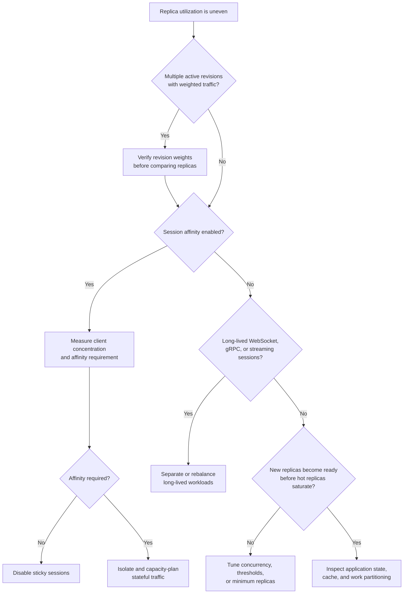

---
content_sources:
  references:
    - type: mslearn-adapted
      url: https://learn.microsoft.com/en-us/azure/container-apps/ingress-overview
  diagrams:
    - id: replica-load-imbalance-decision-flow
      type: flowchart
      source: mslearn-adapted
      based_on:
        - https://learn.microsoft.com/en-us/azure/container-apps/ingress-overview
        - https://learn.microsoft.com/en-us/azure/container-apps/scale-app
        - https://learn.microsoft.com/en-us/azure/container-apps/traffic-splitting
content_validation:
  status: verified
  last_reviewed: 2026-07-18
  reviewer: ai-agent
  core_claims:
    - claim: Azure Container Apps supports scale rules that determine how replicas scale for an app.
      source: https://learn.microsoft.com/en-us/azure/container-apps/scale-app
      verified: true
    - claim: Azure Container Apps supports ingress configuration features such as traffic management and sticky sessions.
      source: https://learn.microsoft.com/en-us/azure/container-apps/ingress-overview
      verified: true
---
# Replica Load Imbalance

Use this playbook when one replica becomes hot while others stay underused, or when a steady workload produces uneven latency across otherwise healthy replicas.

## Symptom

- One replica shows higher CPU, memory, or latency than the rest.
- Request throughput does not spread evenly during a steady load test.
- Sticky-session traffic or long-lived connections keep returning to the same replica.
- Scale-out happens, but the new replicas do not meaningfully reduce the hottest replica load.

## Possible Causes

- Session affinity is concentrating user flows on a subset of replicas.
- Long-lived WebSocket, gRPC, or streaming connections pin work to earlier replicas.
- HTTP concurrency is too high, so a hot replica accepts too much work before more replicas are added.
- Revision traffic weights are correct, but the issue is inside a single revision at replica level.
- Downstream caching or state locality causes specific replicas to do disproportionate work.

## Diagnosis Steps

<!-- diagram-id: replica-load-imbalance-decision-flow -->


*Figure: Revision traffic splitting and replica load balancing are different layers; session affinity and long-lived connections can intentionally concentrate requests.*

### 1. Confirm ingress behavior and whether sticky sessions are enabled

```bash
az containerapp show \
    --name "$APP_NAME" \
    --resource-group "$RG" \
    --query "properties.configuration.ingress" \
    --output json
```

| Command or parameter | Purpose |
| --- | --- |
| `az containerapp show` | Retrieves the full ingress configuration for the named app, exposing sticky-session state, custom domain bindings, and client affinity settings that determine whether requests route consistently to the same replica. |
| `--name` | Specifies the app name; ensures the ingress configuration is read from the intended workload resource, not a similarly named app in another group. |
| `--output` | Preserves the ingress subtree as JSON so the affinity setting and related routing fields remain structured. |
| `--query` | Projects `properties.configuration.ingress`, excluding template and identity data from the sticky-session check. |
| `--resource-group` | Scopes the lookup to a specific resource group, preventing reads from a same-named app in a different subscription or group. |

Record whether `stickySessions.affinity` is set and what `affinity` value is in use. This setting is the primary control for whether requests from the same client route to the same replica or spread across replicas.

### 2. Check scale rules and replica limits

```bash
az containerapp show \
    --name "$APP_NAME" \
    --resource-group "$RG" \
    --query "properties.template.scale" \
    --output json
```

| Command or parameter | Purpose |
| --- | --- |
| `az containerapp show` | Reads the complete container app definition to access the scale configuration and examine minReplicas, maxReplicas, and the active scale rules governing replica provisioning. |
| `--name` | Names the specific app; ensures scale configuration is from the correct workload, not from a duplicate name in a different resource group. |
| `--output` | Emits the selected scale object as JSON, retaining replica limits and each rule's nested metadata for analysis. |
| `--query` | Isolates `properties.template.scale` so `minReplicas`, `maxReplicas`, and active rules can be reviewed without unrelated app configuration. |
| `--resource-group` | Restricts the query to the target resource group, preventing contamination from a same-named app in another group or subscription. |

Record `minReplicas`, `maxReplicas`, and the list of active scale rules (`rules[].name`, `rules[].type`, `rules[].metadata.type`, and `rules[].scaleRuleAuth` settings). A low `minReplicas` combined with high latency to scale new replicas may cause the first replica to saturate before relief arrives.

### 3. Compare request timing and replica events

```bash
az monitor metrics list \
    --resource "/subscriptions/<subscription-id>/resourceGroups/$RG/providers/Microsoft.App/containerApps/$APP_NAME" \
    --metric Requests \
    --aggregation Total \
    --filter "podName eq '*'" \
    --offset PT1H
```

| Command or parameter | Purpose |
| --- | --- |
| `az monitor metrics list` | Retrieves the container app's `Requests` time series from Azure Monitor for the selected one-hour window. |
| `--aggregation` | Applies `Total` to each request interval, producing traffic volume that can be compared with replica lifecycle events. |
| `--filter` | Splits `Requests` into one series per `podName`, the documented replica dimension, so each replica's request volume can be compared after scale-out. |
| `--metric` | Selects the `Requests` series as the workload signal for the suspected concentration period. |
| `--resource` | Targets the specific Container Apps resource using its full resource ID; prevents queries from accidentally reading metrics from a same-named app in a different subscription or resource group. |
| `--offset` | Uses a `PT1H` lookback from the current time, keeping the comparison focused on the recent imbalance event. |

Use the system-log query below to establish when replicas started and became ready, then compare those timestamps with the corresponding `podName` series in the `Requests` metric. The metric supplies per-replica request volume; the logs supply replica lifecycle and affinity evidence.

```kusto
let AppName = "ca-myapp";
ContainerAppSystemLogs_CL
| where ContainerAppName_s == AppName
| where TimeGenerated > ago(2h)
| where Reason_s has_any ("ReplicaStarted", "ReplicaReady")
   or Log_s has_any ("affinity", "session", "connection")
| project TimeGenerated, RevisionName_s, ReplicaName_s, Reason_s, Log_s
| order by TimeGenerated desc
```

Parse `ReplicaStarted` and `ReplicaReady` events to identify when new replicas came online. Cross-reference these timestamps with the request-count metric timeseries to determine whether request load remained pinned to the original replica or if the new replica received traffic. If the hot replica retained its high throughput despite new replicas appearing, session affinity or connection pinning is likely in effect.

### 4. If multiple revisions are active, verify that the problem is not a traffic-splitting issue

```bash
az containerapp show \
    --name "$APP_NAME" \
    --resource-group "$RG" \
    --query "properties.configuration.ingress.traffic" \
    --output json
```

| Command or parameter | Purpose |
| --- | --- |
| `az containerapp show` | Fetches the container app configuration to expose traffic-splitting rules between active revisions, allowing diagnosis of whether the load imbalance is at the revision level or within a single revision's replicas. |
| `--name` | Identifies the app by name; ensures the traffic configuration is read from the correct resource, not a duplicate in a different group. |
| `--output` | Keeps the revision weights and labels in JSON so the configured split can be compared without losing field structure. |
| `--query` | Extracts `properties.configuration.ingress.traffic`, separating revision-level allocation from replica-level balancing evidence. |
| `--resource-group` | Scopes the query to the target resource group, preventing reads from a same-named app in another subscription or group. |

If multiple revisions are active and weights are not 0/100 split, calculate whether the observed load distribution matches the configured weights. A revision receiving 50% of the traffic should see approximately half the request count of a 100%-weight revision, assuming identical workload profiles. If the distribution does not match, the imbalance is likely at the replica level (affinity, pinning) rather than a traffic-splitting misconfiguration.

## Resolution

1. Disable sticky sessions for stateless routes, or isolate stateful endpoints where affinity is required.
2. Lower per-replica concurrency or scale thresholds so new replicas become useful sooner.
3. Increase `minReplicas` during steady high-volume periods.
4. Reduce long-lived connection concentration by separating streaming traffic from normal HTTP traffic.
5. If state locality is deliberate, adjust expectations and monitor by replica cohort instead of assuming perfect balance.

## Prevention

- Decide explicitly whether affinity is required before enabling it.
- Test with both short-lived and long-lived request patterns.
- Validate scale rules using steady-state as well as burst traffic.
- Keep revision traffic-splitting and replica-level load balancing conceptually separate in incident reviews.
- Instrument per-replica behavior in application telemetry where possible.

## See Also

- [CPU Throttling](cpu-throttling.md)
- [Session Affinity Failure](../networking-advanced/session-affinity-failure.md)
- [WebSocket and gRPC Ingress](../networking-advanced/websocket-grpc-ingress.md)

## Sources

- [Ingress in Azure Container Apps](https://learn.microsoft.com/en-us/azure/container-apps/ingress-overview)
- [Scaling in Azure Container Apps](https://learn.microsoft.com/en-us/azure/container-apps/scale-app)
- [Traffic splitting in Azure Container Apps](https://learn.microsoft.com/en-us/azure/container-apps/traffic-splitting)
