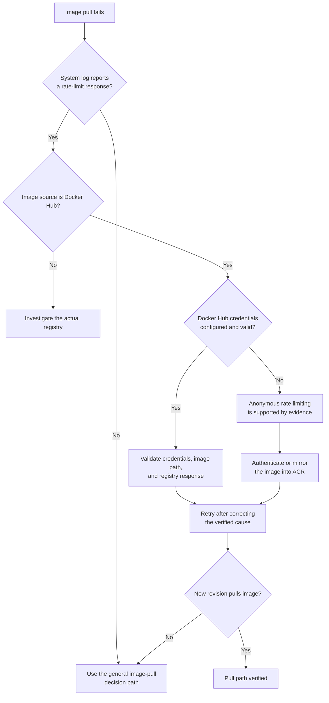

---
content_sources:
  references:
    - type: mslearn-adapted
      url: https://learn.microsoft.com/en-us/azure/container-apps/containers#container-registries
  diagrams:
    - id: docker-hub-rate-limit-decision-flow
      type: flowchart
      source: mslearn-adapted
      based_on:
        - https://learn.microsoft.com/en-us/azure/container-apps/containers#container-registries
        - https://learn.microsoft.com/en-us/azure/container-apps/troubleshoot-container-start-failures
        - https://learn.microsoft.com/en-us/azure/container-registry/container-registry-authentication
content_validation:
  status: verified
  last_reviewed: 2026-07-18
  reviewer: ai-agent
  core_claims:
    - claim: Azure Container Apps can pull images from public and private container registries.
      source: https://learn.microsoft.com/en-us/azure/container-apps/containers#container-registries
      verified: true
    - claim: Registry authentication configuration is part of troubleshooting container start failures in Azure Container Apps.
      source: https://learn.microsoft.com/en-us/azure/container-apps/troubleshoot-container-start-failures
      verified: true
---
# Docker Hub Rate Limit

Use this playbook when new revisions fail to start or scale-out events fail intermittently because Docker Hub anonymous pull limits are exhausted.

## Symptom

- System logs show image pull failures with `toomanyrequests` or similar pull-rate messages.
- Revisions fail during provisioning even though the image name and tag are correct.
- The same image may work at low frequency but fail during repeated deployments or burst scale-out.
- Pull failures disappear temporarily after waiting for the registry limit window to reset.

## Possible Causes

- The app pulls from Docker Hub without authenticated registry credentials.
- Multiple revisions or environments share the same anonymous pull budget.
- Scale-out after idle or deployment retries causes repeated image pulls in a short interval.
- The workload depends on public base images that are not mirrored into a controlled registry.

## Diagnosis Steps

<!-- diagram-id: docker-hub-rate-limit-decision-flow -->


*Figure: A `toomanyrequests` registry response supports the rate-limit hypothesis; image source and authentication still need independent verification.*

1. Confirm the configured image source and capture the system log message.

    ```bash
    az containerapp show \
        --name "$APP_NAME" \
        --resource-group "$RG" \
        --query "properties.template.containers[0].image" \
        --output tsv

    az containerapp logs show \
        --name "$APP_NAME" \
        --resource-group "$RG" \
        --type system
    ```

    | Command or parameter | Purpose |
    |---|---|
    | `az containerapp show` | Read the image URI to verify whether it references Docker Hub (index.docker.io) or another registry. |
    | `az containerapp logs show` | Capture the exact system-level pull error including response codes and rate-limit indicators. |
    | `--name` | Target the app under investigation. |
    | `--output` | Format image as tsv for parsing. |
    | `--query` | Extract the container image configuration value. |
    | `--resource-group` | Scope to the resource group containing the app. |
    | `--type` | Request system logs for registry-level pull errors and platform events. |

2. Review registry configuration for the app.

    ```bash
    az containerapp show \
        --name "$APP_NAME" \
        --resource-group "$RG" \
        --query "properties.configuration.registries" \
        --output json
    ```

    | Command or parameter | Purpose |
    |---|---|
    | `az containerapp show` | List all configured registry credentials to check whether Docker Hub authentication is present. |
    | `--name` | Target the app being debugged. |
    | `--output` | Format as json to preserve the full registry configuration structure. |
    | `--query` | Extract the registries array to see all configured pull credentials. |
    | `--resource-group` | Keep the query in the resource group containing the affected app. |

3. Search for repeated rate-limit errors during deployment or scale-out windows.

    ```kusto
    let AppName = "ca-myapp";
    ContainerAppSystemLogs_CL
    | where ContainerAppName_s == AppName
    | where TimeGenerated > ago(2h)
    | where Log_s has_any ("toomanyrequests", "rate limit", "pull rate limit")
    | project TimeGenerated, RevisionName_s, Reason_s, Log_s
    | order by TimeGenerated desc
    ```

| Command or Query | Why it is used |
|---|---|
| `az containerapp show --query image` | Confirm the app is pulling from Docker Hub and not a private registry that may have different limits. |
| `az containerapp logs show --type system` | Capture the exact HTTP response from Docker Hub indicating rate-limit exhaustion. |
| `az containerapp show --query registries` | Check whether authentication credentials have been configured for Docker Hub, which would bypass anonymous limits. |
| KQL for rate-limit text | Distinguish one-time pull failures from sustained rate-limit blocking across multiple revisions or scale attempts. |

## Resolution

1. Add authenticated registry credentials if you must pull directly from Docker Hub.
2. Prefer mirroring the image into Azure Container Registry so deployments and scale-out use a controlled source.
3. Reduce unnecessary revision churn while validating the fix.
4. Re-deploy only after registry configuration is updated.

    ```bash
    az containerapp registry set \
        --name "$APP_NAME" \
        --resource-group "$RG" \
        --server "index.docker.io" \
        --username "<docker-hub-username>" \
        --password "<docker-hub-access-token>"
    ```

    | Command or parameter | Purpose |
    |---|---|
    | `az containerapp registry set` | Configure Docker Hub credentials for authenticated pulls that bypass anonymous rate limits. |
    | `--name` | Apply credentials to the specified container app. |
    | `--password` | Provide a Docker Hub personal access token (preferred over a password). |
    | `--resource-group` | Update the app in the target resource group. |
    | `--server` | Use the Docker Hub registry FQDN (index.docker.io). |
    | `--username` | Specify the Docker Hub username associated with the access token. |

## Prevention

- Treat public Docker Hub pulls as an external dependency with rate risk.
- Mirror production images into ACR before high-frequency deployment or scale testing.
- Use stable image references and avoid repeated failed retries against the same public source.
- Document which apps still depend on public registry pulls.

## See Also

- [Image Pull Failure](image-pull-failure.md)
- [Image Size Startup Delay](image-size-startup-delay.md)
- [Multi-Arch Image Mismatch](multi-arch-image-mismatch.md)

## Sources

- [Container registries in Azure Container Apps](https://learn.microsoft.com/en-us/azure/container-apps/containers#container-registries)
- [Troubleshoot container start failures in Azure Container Apps](https://learn.microsoft.com/en-us/azure/container-apps/troubleshoot-container-start-failures)
- [Authentication with Azure Container Registry](https://learn.microsoft.com/en-us/azure/container-registry/container-registry-authentication)
