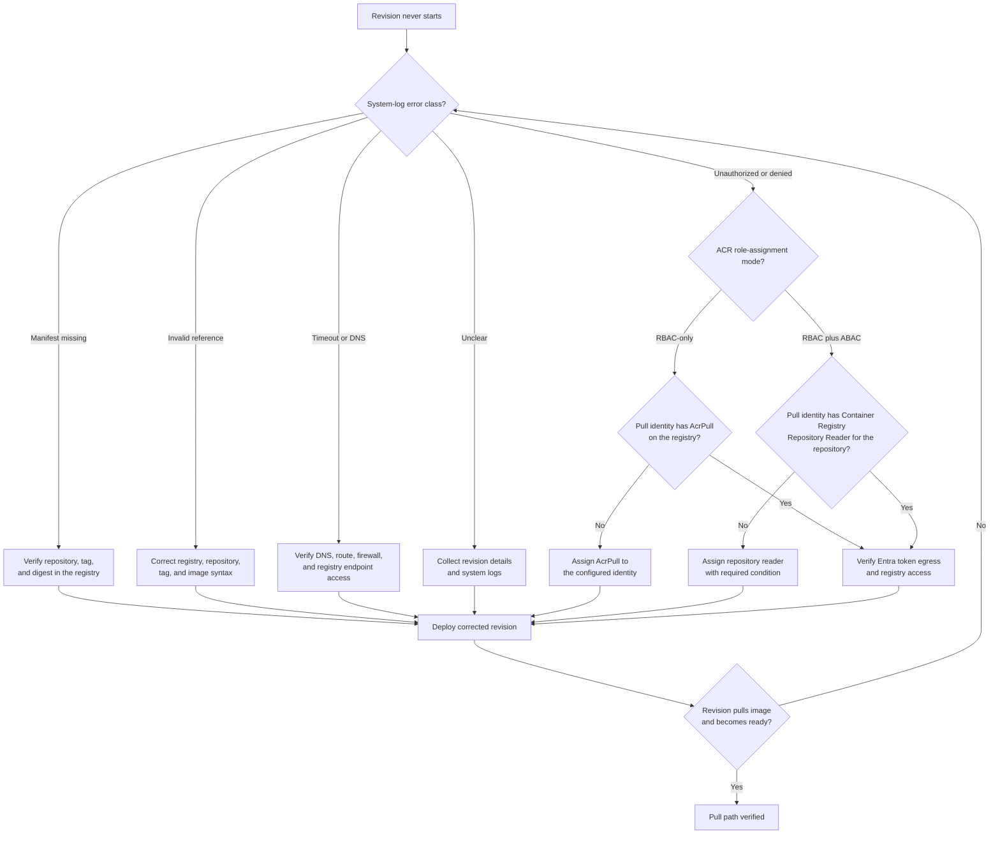

---
content_sources:
  diagrams:
    - id: troubleshooting-decision-flow
      type: flowchart
      source: mslearn-adapted
      based_on:
        - https://learn.microsoft.com/en-us/azure/container-apps/containers#container-registries
        - https://learn.microsoft.com/en-us/azure/container-apps/managed-identity
        - https://learn.microsoft.com/en-us/azure/container-apps/managed-identity-image-pull
        - https://learn.microsoft.com/en-us/azure/container-apps/firewall-integration
        - https://learn.microsoft.com/en-us/azure/container-apps/user-defined-routes
        - https://learn.microsoft.com/en-us/azure/container-apps/troubleshooting
        - https://learn.microsoft.com/en-us/azure/container-registry/container-registry-authentication
        - https://learn.microsoft.com/en-us/azure/container-registry/container-registry-rbac-built-in-roles-overview
        - https://learn.microsoft.com/en-us/azure/container-registry/container-registry-rbac-abac-repository-permissions
content_validation:
  status: verified
  last_reviewed: 2026-09-11
  reviewer: ai-agent
  core_claims:
    - claim: Azure Container Apps can pull container images from public and private registries, including Azure Container Registry.
      source: https://learn.microsoft.com/en-us/azure/container-apps/containers
      verified: true
    - claim: Azure Container Apps supports both system-assigned and user-assigned managed identities.
      source: https://learn.microsoft.com/en-us/azure/container-apps/managed-identity
      verified: true
    - claim: In workload profiles environments with restricted egress, outbound access to the AzureActiveDirectory service tag on port 443 is required when using managed identity.
      source: https://learn.microsoft.com/en-us/azure/container-apps/firewall-integration
      verified: true
    - claim: Azure Container Apps can authenticate Azure Container Registry image pulls with managed identity instead of registry admin credentials.
      source: https://learn.microsoft.com/en-us/azure/container-apps/managed-identity-image-pull
      verified: true
    - claim: Azure Container Registry uses AcrPull for RBAC-only registries, while RBAC Registry plus ABAC Repository Permissions mode uses Container Registry Repository Reader for repository pulls.
      source: https://learn.microsoft.com/en-us/azure/container-registry/container-registry-rbac-built-in-roles-overview
      verified: true
---
# Image Pull Failure

## 1. Summary

### Symptom

Revision remains stuck in `Failed` or `Provisioning` state and never becomes healthy. The container never starts because the platform cannot pull the configured image. Application logs are empty because no code ever executes.

### Why this scenario is confusing

Image pull failures look similar to app crashes at first glance—both result in unhealthy revisions. However, the root cause is entirely different: networking, authentication, or image reference issues rather than application code. Without checking system logs, you might waste time debugging code that never ran.

### Troubleshooting decision flow

<!-- diagram-id: troubleshooting-decision-flow -->


*Figure: `AcrPull` applies to RBAC-only registries; registries using RBAC plus ABAC repository permissions require the repository-reader role path.*

## 2. Common Misreadings

- "The app code is crashing" — If image pull fails, your app code never executes. No point debugging application logic.
- "ACR is down" — Most incidents are identity scope issues, wrong tag, or registry URL mismatch, not ACR outages.
- "I just pushed the image, it should be there" — Push succeeded to wrong repository, wrong registry, or tag was overwritten.
- "Managed identity is configured" — Identity exists but lacks the pull role honored by the registry mode: `AcrPull` for RBAC-only or `Container Registry Repository Reader` for ABAC-enabled mode.
- "It worked yesterday" — Image tag was overwritten with broken image, or RBAC was modified.

## 3. Competing Hypotheses

| Hypothesis | Typical Evidence For | Typical Evidence Against |
|---|---|---|
| **H1: Registry authentication failure** | `unauthorized`, `denied`, `403`, missing role assignment | Same identity pulls successfully elsewhere |
| **H2: Image tag doesn't exist** | `manifest unknown`, `not found`, tag missing from ACR | Tag exists and digest is resolvable |
| **H3: Network path blocked** | Timeout, connection refused, DNS resolution failure | Same environment pulls other images successfully |
| **H4: Malformed image reference** | Invalid format errors, empty image field | Image reference parses correctly |
| **H5: Restricted egress blocks managed identity token acquisition, which can surface as `unauthorized`** | `unauthorized` appears even though `AcrPull` is correct, issue starts after UDR/firewall tightening, managed identity image pull depends on `AzureActiveDirectory` egress | Same environment can reach required outbound dependencies and only one app is misconfigured |

## 4. What to Check First

### Metrics

- Failed revision count in Azure Portal
- Provisioning duration (stuck revisions show extended duration)
- No replica metrics (replicas never created)

### Logs

```kusto
let AppName = "ca-myapp";
ContainerAppSystemLogs_CL
| where ContainerAppName_s == AppName
| where TimeGenerated > ago(1h)
| where Reason_s has_any ("ImagePullBackOff", "ErrImagePull", "Failed")
   or Log_s has_any ("pull", "manifest", "unauthorized", "denied", "timeout", "connection refused")
| project TimeGenerated, RevisionName_s, Reason_s, Log_s
| order by TimeGenerated desc
```

### Platform Signals

```bash
# Check configured image
az containerapp show --name "$APP_NAME" --resource-group "$RG" \
  --query "properties.template.containers[0].image" --output tsv

# Check revision status
az containerapp revision list --name "$APP_NAME" --resource-group "$RG" \
  --query "[].{name:name,health:properties.healthState,created:properties.createdTime}" \
  --output table

# Check system logs for pull errors
az containerapp logs show --name "$APP_NAME" --resource-group "$RG" --type system
```

| Command or parameter | Purpose |
|---|---|
| `az containerapp show` | Displays the configured image URI to verify what the app is trying to pull. |
| `az containerapp revision list` | Shows all revisions with their health states and timelines to identify which revision failed. |
| `az containerapp logs show` | Captures system logs where pull errors and auth messages appear. |
| `--name` | Specifies the app to inspect. |
| `--output` | Formats image as `tsv` for parsing, revisions as `table` for easy visual scanning. |
| `--query` | Extracts the image URI and revision health to check provisioning status. |
| `--resource-group` | Limits the lookup to the resource group containing the app. |
| `--type` | Requests `system` logs (pull failures, auth errors, not application output). |

## 5. Evidence to Collect

### Required Evidence

| Evidence | Command/Query | Purpose |
|---|---|---|
| Configured image | `az containerapp show ... --query containers[0].image` | Verify image reference |
| Revision health | `az containerapp revision list` | Confirm stuck/failed state |
| System logs | KQL for pull errors | Find specific error message |
| Identity config | `az containerapp show ... --query identity` | Check managed identity |
| ACR role-assignment mode | `az acr show ... --query roleAssignmentMode` | Choose the RBAC-only or ABAC-enabled role path |
| ACR role assignment | `az role assignment list --scope <acr-id>` | Verify the mode-appropriate pull role and any repository condition |
| ACR tag existence | `az acr repository show-tags` | Confirm tag exists |

### Useful Context

- Registry type (ACR, Docker Hub, private registry)
- Authentication method (managed identity, admin credentials, service principal)
- Network configuration (public ACR, private endpoint, firewall)
- Recent changes (new image push, RBAC modification, network change)

## 6. Validation and Disproof by Hypothesis

### H1: Registry authentication failure

Before testing a role assignment, inspect the registry's `roleAssignmentMode`. Use the `AcrPull` path only for an RBAC-only registry. For `rbac-abac` mode, use `Container Registry Repository Reader` and the repository condition required by the registry's ABAC policy.

**Signals that support:**

- System logs show `unauthorized`, `denied`, `403`
- Managed identity exists but lacks the pull role honored by the registry's role-assignment mode
- ACR admin credentials disabled but app expects them
- Different registry used than expected

**Signals that weaken:**

- Same identity successfully pulls other images
- Role assignment exists and is correct
- Using public image that doesn't require auth

**What to verify:**

```bash
# Check managed identity
az containerapp show --name "$APP_NAME" --resource-group "$RG" \
  --query "identity" --output json

# Get identity principal ID
PRINCIPAL_ID=$(az containerapp show --name "$APP_NAME" --resource-group "$RG" \
  --query "identity.principalId" --output tsv)

# Identify whether the registry uses RBAC-only or ABAC-enabled permissions
ROLE_ASSIGNMENT_MODE=$(az acr show --name "$ACR_NAME" --resource-group "$RG" \
  --query "roleAssignmentMode" --output tsv)

# Check mode-appropriate role assignments and ABAC conditions
ACR_ID=$(az acr show --name "$ACR_NAME" --resource-group "$RG" \
  --query "id" --output tsv)
az role assignment list --scope "$ACR_ID" --assignee "$PRINCIPAL_ID" --output table
```

| Command or parameter | Purpose |
|---|---|
| `az containerapp show` | Reads the managed identity assigned to the app for role assignment lookup. |
| `az acr show` | Retrieves both the registry's role-assignment mode and its resource ID before checking permissions. |
| `az role assignment list` | Lists assignments for the identity so you can verify `AcrPull` in RBAC-only mode or `Container Registry Repository Reader` and its condition in ABAC-enabled mode. |
| `--assignee` | Filters the role assignment list to show only assignments for the container app's principal ID. |
| `--name` | Names the app and registry to retrieve their identity and resource ID. |
| `--output` | Formats identity as `json` to preserve structure, registry ID as `tsv` for shell assignment, role list as `table` for readability. |
| `--query` | Extracts the app principal ID, registry `roleAssignmentMode`, or registry resource ID for the mode-aware role check. |
| `--resource-group` | Limits the lookup to the resource group containing both the app and registry. |
| `--scope` | Targets the ACR resource when listing role assignments, so only assignments on that registry are shown. |

```kusto
// Find auth errors
let AppName = "ca-myapp";
ContainerAppSystemLogs_CL
| where ContainerAppName_s == AppName
| where TimeGenerated > ago(2h)
| where Log_s has_any ("unauthorized", "denied", "403", "authentication", "credential")
| project TimeGenerated, Log_s
| order by TimeGenerated desc
```

**Fix:**

If `ROLE_ASSIGNMENT_MODE` is `rbac`, use the RBAC-only command below. If it is `rbac-abac`, use the ABAC-enabled command. The ABAC command grants registry-wide repository read access; to restrict the identity to the image's repository, add a repository-name condition by following [Scope role assignment to a specific repository](https://learn.microsoft.com/en-us/azure/container-registry/container-registry-rbac-abac-repository-permissions#scope-role-assignment-to-a-specific-repository). Do not use `AcrPull` in `rbac-abac` mode because that role is not honored there.

```bash
# RBAC-only registry: assign AcrPull
az role assignment create \
  --assignee "$PRINCIPAL_ID" \
  --role "AcrPull" \
  --scope "$ACR_ID"

# ABAC-enabled registry: assign repository read permission
az role assignment create \
  --assignee "$PRINCIPAL_ID" \
  --role "Container Registry Repository Reader" \
  --scope "$ACR_ID"

# Or configure registry credentials
az containerapp registry set \
  --name "$APP_NAME" \
  --resource-group "$RG" \
  --server "$ACR_NAME.azurecr.io" \
  --identity system
```

| Command or parameter | Purpose |
|---|---|
| `az role assignment create` | Grants the mode-appropriate pull role to the app's identity on the specific ACR registry. |
| `az containerapp registry set` | Configures the app to authenticate to a registry using its system-assigned managed identity. |
| `--assignee` | Identifies the managed identity principal ID that receives the pull role. |
| `--identity` | Specifies `system` to use the app's system-assigned managed identity for pulling. |
| `--name` | Names the app to configure for image pull. |
| `--resource-group` | Limits the operation to the resource group containing the app. |
| `--role` | Uses `AcrPull` only for RBAC-only mode or `Container Registry Repository Reader` for ABAC-enabled mode. |
| `--scope` | Targets the ACR resource (not a subscription or resource group) to limit the role scope. |
| `--server` | Sets the ACR FQDN (e.g., `myacr.azurecr.io`) so the app knows which registry to authenticate to. |

### H2: Image tag doesn't exist

**Signals that support:**

- System logs show `manifest unknown`, `not found`
- Tag not listed in ACR repository
- Typo in image reference

**Signals that weaken:**

- Tag exists in ACR and digest matches
- Auth errors appear instead of manifest errors

**What to verify:**

```bash
# Check if tag exists
az acr repository show-tags --name "$ACR_NAME" --repository "myapp" --output table

# Check manifest
az acr manifest show --registry "$ACR_NAME" --name "myapp:v1.0.0"

# Verify exact image reference in app
az containerapp show --name "$APP_NAME" --resource-group "$RG" \
  --query "properties.template.containers[0].image" --output tsv
```

| Command or parameter | Purpose |
|---|---|
| `az acr repository show-tags` | Lists all tags in a repository to confirm the expected tag exists. |
| `az acr manifest show` | Displays manifest metadata to verify the tag resolves to a digest. |
| `az containerapp show` | Reads the app's configured image URI to check for typos or mismatches. |
| `--name` | Names the app or specifies the image reference for lookup. |
| `--output` | Formats tags as `table` for human scanning, image as `tsv` for shell parsing. |
| `--query` | Extracts only the image URI, avoiding unrelated app configuration. |
| `--registry` | Names the ACR to look up the manifest in. |
| `--repository` | Names the repository within ACR to list available tags. |
| `--resource-group` | Limits the app lookup to the resource group. |

```kusto
// Find manifest errors
let AppName = "ca-myapp";
ContainerAppSystemLogs_CL
| where ContainerAppName_s == AppName
| where TimeGenerated > ago(2h)
| where Log_s has_any ("manifest unknown", "not found", "does not exist")
| project TimeGenerated, Log_s
```

**Fix:**

```bash
# Push correct image
az acr build --registry "$ACR_NAME" --image "myapp:v1.0.0" .

# Or update app to use existing tag
az containerapp update --name "$APP_NAME" --resource-group "$RG" \
  --image "$ACR_NAME.azurecr.io/myapp:existing-tag"
```

| Command or parameter | Purpose |
|---|---|
| `az acr build` | Builds the image from a local Dockerfile and pushes it to ACR with the specified tag. |
| `az containerapp update` | Reconfigures the app to pull a known-good tag from ACR. |
| `--image` | Specifies the ACR image URI (registry/repository:tag) to pull. |
| `--name` | Names the app to update. |
| `--registry` | Names the ACR to build the image in. |
| `--resource-group` | Limits the operation to the resource group. |

### H3: Network path blocked

**Signals that support:**

- System logs show timeout, connection refused, DNS failure
- ACR is private but environment not VNet-integrated
- Private endpoint exists but DNS not configured
- Firewall blocking outbound to ACR

**Signals that weaken:**

- Same environment successfully pulls other ACR images
- Public ACR with no network restrictions

**What to verify:**

```bash
# Check if ACR is public or private
az acr show --name "$ACR_NAME" --query "publicNetworkAccess" --output tsv

# Check environment VNet integration
az containerapp env show --name "$ACA_ENV_NAME" --resource-group "$RG" \
  --query "properties.vnetConfiguration" --output json

# Check ACR private endpoint (if applicable)
az network private-endpoint list --resource-group "$RG" \
  --query "[?contains(name, 'acr')]" --output table
```

| Command or parameter | Purpose |
|---|---|
| `az acr show` | Displays the registry's public-network-access setting. |
| `az containerapp env show` | Displays the environment's VNet integration configuration. |
| `az network private-endpoint list` | Shows private endpoints in the resource group to identify ACR connectivity paths. |
| `--name` | Names the ACR and environment to inspect. |
| `--output` | Formats as `tsv` or `json` or `table` depending on the command's output preference. |
| `--query` | Extracts public-access, VNet configuration, and filters endpoints by name. |
| `--resource-group` | Limits the lookup to the resource group. |

**Fix:**

```bash
# For private ACR, ensure private DNS zone is linked
az network private-dns zone list --resource-group "$RG" --output table

# Or allow the documented outbound public IP or CIDR in the ACR firewall
az acr network-rule add --name "$ACR_NAME" --resource-group "$RG" \
  --ip-address "<environment-outbound-ip-or-cidr>"
```

| Command or parameter | Purpose |
|---|---|
| `az network private-dns zone list` | Shows private DNS zones linked to the ACR private endpoint. |
| `az acr network-rule add` | Adds the environment's outbound IP to the ACR firewall allow list. |
| `--ip-address` | Specifies the environment's public outbound IP or CIDR to whitelist. |
| `--name` | Names the ACR to modify. |
| `--output` | Formats as `table` for readability. |
| `--resource-group` | Limits the operation to the resource group. |

### H4: Malformed image reference

**Signals that support:**

- Image field empty or malformed
- Missing registry prefix
- Invalid characters in image name

**Signals that weaken:**

- Image reference parses correctly
- Same reference works in docker pull locally

**What to verify:**

```bash
# Check image format
IMAGE=$(az containerapp show --name "$APP_NAME" --resource-group "$RG" \
  --query "properties.template.containers[0].image" --output tsv)
echo "Configured image: $IMAGE"

# Validate format: registry/repository:tag
# Examples:
# ✅ myacr.azurecr.io/myapp:v1.0.0
# ✅ docker.io/library/nginx:latest
# ❌ myapp:v1.0.0 (missing registry)
# ❌ myacr.azurecr.io/myapp (missing tag)
```

| Command or parameter | Purpose |
|---|---|
| `az containerapp show` | Displays the configured image reference. |
| `--name` | Names the app to inspect. |
| `--output` | Formats as `tsv` so the image reference is easy to extract and validate. |
| `--query` | Extracts only the image URI. |
| `--resource-group` | Limits the lookup to the resource group. |

### H5: Auth-looking `unauthorized` that can indicate restricted egress blocking managed identity token acquisition

**Signals that support:**

- System logs show `unauthorized` or `denied`, but the container app identity already has the `AcrPull` role on the correct registry
- The failure starts after adding UDRs, Azure Firewall rules, or restrictive NSG outbound rules
- The environment uses managed identity for image pulls and ACR is behind private networking or other restricted egress controls
- Other evidence points to outbound dependency gaps rather than registry RBAC, especially missing access to `AzureActiveDirectory` on port `443`

**Signals that weaken:**

- `AcrPull` is actually missing or assigned to the wrong principal or wrong registry
- The environment has unrestricted outbound access or explicit allow rules for `AzureActiveDirectory`, `MicrosoftContainerRegistry`, `AzureFrontDoor.FirstParty`, and required ACR dependencies
- The same environment can successfully perform other managed identity-dependent operations after the egress policy change

**What to verify:**

```bash
# Confirm the container app is using managed identity for the registry
az containerapp show --name "$APP_NAME" --resource-group "$RG" \
  --query "properties.configuration.registries" --output json

# Confirm the identity and AcrPull assignment are correct
PRINCIPAL_ID=$(az containerapp show --name "$APP_NAME" --resource-group "$RG" \
  --query "identity.principalId" --output tsv)
ACR_ID=$(az acr show --name "$ACR_NAME" --resource-group "$RG" --query "id" --output tsv)
az role assignment list --scope "$ACR_ID" --assignee "$PRINCIPAL_ID" --output table

# Check whether the environment subnet is attached to an NSG or route table
INFRA_SUBNET_ID=$(az containerapp env show --name "$ACA_ENV_NAME" --resource-group "$RG" \
  --query "properties.vnetConfiguration.infrastructureSubnetId" --output tsv)
az network vnet subnet show --ids "$INFRA_SUBNET_ID" \
  --query "{routeTableId:routeTable.id,nsgId:networkSecurityGroup.id}" --output json

# Review the attached NSG and route table definitions if they exist
NSG_ID=$(az network vnet subnet show --ids "$INFRA_SUBNET_ID" \
  --query "networkSecurityGroup.id" --output tsv)
ROUTE_TABLE_ID=$(az network vnet subnet show --ids "$INFRA_SUBNET_ID" \
  --query "routeTable.id" --output tsv)
if [ -n "$NSG_ID" ]; then
  az resource show --ids "$NSG_ID" --output json
fi

if [ -n "$ROUTE_TABLE_ID" ]; then
  az resource show --ids "$ROUTE_TABLE_ID" --output json
fi

# Inspect the NSG or route table resources for outbound controls and verify the allow-list includes:
# AzureActiveDirectory:443
# MicrosoftContainerRegistry:443
# AzureFrontDoor.FirstParty:443
# Storage.<Region>:443
# Your ACR endpoint or AzureContainerRegistry when not using an ACR private endpoint
```

| Command or parameter | Purpose |
|---|---|
| `az containerapp show` | Returns the registry server, selected pull identity, and principal ID needed to distinguish a wrong identity binding from blocked token acquisition. |
| `az acr show` | Retrieves the registry resource ID used to verify that the pull identity's role assignment is scoped to the ACR that rejected the request. |
| `az role assignment list` | Lists the roles held by the container app principal at the ACR scope, showing whether the expected pull permission is present before investigating egress. |
| `az containerapp env show` | Finds the infrastructure subnet whose route table and NSG control the environment's outbound path to identity and registry endpoints. |
| `az network vnet subnet show` | Resolves the route-table and NSG IDs attached to that subnet so forced tunneling and egress filtering can be inspected separately. |
| `az resource show` | Reads the referenced route table or NSG resource when its provider-specific command is not yet known, preserving the complete rule configuration for review. |
| `--assignee` | Filters the RBAC results to `"$PRINCIPAL_ID"`, the managed identity used by the app for the registry pull. |
| `--ids` | Reads the infrastructure subnet, then its attached NSG and route table by resource ID so their actual outbound controls can be reviewed. |
| `--name` | Selects the container app, ACR, and Container Apps environment whose identity, registry scope, and infrastructure subnet are being correlated. |
| `--output` | Emits structured configuration as JSON, shell-assigned IDs as TSV, and role assignments as a table so each result is usable in the next check. |
| `--query` | Extracts the registry identity, principal ID, ACR ID, infrastructure subnet ID, and attached NSG and route-table IDs needed to compare RBAC with outbound controls. |
| `--resource-group` | Reads the app, registry, and environment from `"$RG"` so the identity and network evidence comes from the affected workload deployment. |
| `--scope` | Restricts the role-assignment evidence to `"$ACR_ID"`, distinguishing permissions on the failing registry from broader or unrelated assignments. |

```kusto
// Correlate unauthorized image pull failures with restricted egress investigation
let AppName = "ca-myapp";
ContainerAppSystemLogs_CL
| where ContainerAppName_s == AppName
| where TimeGenerated > ago(4h)
| where Log_s has_any ("unauthorized", "denied", "403", "token")
| project TimeGenerated, RevisionName_s, Reason_s, Log_s
| order by TimeGenerated desc
```

```kusto
// If Azure Firewall logs are enabled, check for denied outbound requests to Entra ID or registry dependencies
AzureDiagnostics
| where TimeGenerated > ago(4h)
| where Category in ("AzureFirewallApplicationRule", "AzureFirewallNetworkRule")
| where msg_s has_any ("login.microsoftonline.com", "mcr.microsoft.com", ".azurecr.io", ".blob.core.windows.net")
| project TimeGenerated, Category, action_s, msg_s
| order by TimeGenerated desc
```

**Fix:**

!!! note "Workload profiles environments only"
    UDR and Azure Firewall egress control applies to **workload profiles** environments. Consumption-only environments do not support user-defined routes.

If outbound traffic is controlled by Azure Firewall through a user-defined route, update the firewall allow-list as well as any NSG rules. These rules supplement your existing baseline Container Apps firewall configuration — they are an incremental patch, not a complete firewall ruleset. The required destinations come from the same Microsoft Learn dependency set: Microsoft Entra ID token acquisition, Microsoft container registry dependencies, your ACR endpoint when not using a private endpoint, and the required storage endpoint for ACR-backed images.

```bash
# If outbound is routed through Azure Firewall, allow the required FQDNs in the firewall policy
az network firewall policy rule-collection-group collection add-filter-collection \
  --policy-name "$FIREWALL_POLICY_NAME" \
  --resource-group "$RG" \
  --rule-collection-group-name "$RULE_COLLECTION_GROUP_NAME" \
  --name "aca-egress-dependencies" \
  --action Allow \
  --collection-priority 100 \
  --rule-type ApplicationRule

az network firewall policy rule-collection-group collection rule add \
  --policy-name "$FIREWALL_POLICY_NAME" \
  --resource-group "$RG" \
  --rule-collection-group-name "$RULE_COLLECTION_GROUP_NAME" \
  --collection-name "aca-egress-dependencies" \
  --name "allow-managed-identity-and-registry-fqdns" \
  --rule-type ApplicationRule \
  --source-addresses "*" \
  --protocols "Http=80" "Https=443" \
  --target-fqdns "login.microsoftonline.com" "*.login.microsoftonline.com" "*.login.microsoft.com" "login.microsoft.com" "*.identity.azure.net" "mcr.microsoft.com" "*.data.mcr.microsoft.com" "$ACR_NAME.azurecr.io" "*.blob.core.windows.net"

# Allow managed identity token acquisition through the environment NSG
az network nsg rule create \
  --resource-group "$RG" \
  --nsg-name "$NSG_NAME" \
  --name "allow-azure-active-directory-443" \
  --priority 200 \
  --direction Outbound \
  --access Allow \
  --protocol Tcp \
  --source-address-prefixes "*" \
  --source-port-ranges "*" \
  --destination-address-prefixes AzureActiveDirectory \
  --destination-port-ranges 443

# Allow registry platform dependencies required by Azure Container Apps
az network nsg rule create \
  --resource-group "$RG" \
  --nsg-name "$NSG_NAME" \
  --name "allow-microsoft-container-registry-443" \
  --priority 210 \
  --direction Outbound \
  --access Allow \
  --protocol Tcp \
  --source-address-prefixes "*" \
  --source-port-ranges "*" \
  --destination-address-prefixes MicrosoftContainerRegistry \
  --destination-port-ranges 443

az network nsg rule create \
  --resource-group "$RG" \
  --nsg-name "$NSG_NAME" \
  --name "allow-azure-front-door-first-party-443" \
  --priority 220 \
  --direction Outbound \
  --access Allow \
  --protocol Tcp \
  --source-address-prefixes "*" \
  --source-port-ranges "*" \
  --destination-address-prefixes AzureFrontDoor.FirstParty \
  --destination-port-ranges 443

az network nsg rule create \
  --resource-group "$RG" \
  --nsg-name "$NSG_NAME" \
  --name "allow-azure-container-registry-443" \
  --priority 225 \
  --direction Outbound \
  --access Allow \
  --protocol Tcp \
  --source-address-prefixes "*" \
  --source-port-ranges "*" \
  --destination-address-prefixes AzureContainerRegistry \
  --destination-port-ranges 443

az network nsg rule create \
  --resource-group "$RG" \
  --nsg-name "$NSG_NAME" \
  --name "allow-storage-region-443" \
  --priority 230 \
  --direction Outbound \
  --access Allow \
  --protocol Tcp \
  --source-address-prefixes "*" \
  --source-port-ranges "*" \
  --destination-address-prefixes "Storage.<Region>" \
  --destination-port-ranges 443

# After restoring outbound access, trigger a new revision
az containerapp update --name "$APP_NAME" --resource-group "$RG" \
  --revision-suffix "egress-fix-$(date +%s)"
```

| Command or parameter | Purpose |
|---|---|
| `az network firewall policy rule-collection-group collection add-filter-collection` | Adds the `aca-egress-dependencies` filter collection to the existing rule-collection group, assigning its action and evaluation priority before application rules are added. |
| `az network firewall policy rule-collection-group collection rule add` | Adds application rules into the created collection, specifying allowed FQDNs (Microsoft Entra ID, container registries, storage) and ports. |
| `az network nsg rule create` | Creates outbound NSG rules to allow traffic to Azure service tags on port 443 for managed identity token acquisition and registry access. Creates five separate rules for each required service tag. |
| `az containerapp update` | Triggers a new revision to test whether outbound egress is now restored and the identity can acquire tokens. |
| `--access` | Specifies `Allow` on NSG rules to permit traffic. |
| `--action` | Specifies `Allow` on firewall policy rules to permit matched traffic. |
| `--collection-name` | Names the rule collection `"aca-egress-dependencies"` so all egress rules are grouped together. |
| `--collection-priority` | Sets priority `100` to control rule evaluation order within the rule collection group. |
| `--destination-address-prefixes` | Allows Azure service tags (`AzureActiveDirectory`, `MicrosoftContainerRegistry`, etc.) so NSG rules apply to dynamic Azure IP ranges. |
| `--destination-port-ranges` | Allows port 443 (HTTPS) for all outbound token and registry traffic. |
| `--direction` | Specifies `Outbound` to control traffic leaving the environment. |
| `--name` | Collection names (`aca-egress-dependencies`), rule names (one per service tag), and app name for updates. |
| `--nsg-name` | Specifies the NSG attached to the infrastructure subnet. |
| `--policy-name` | References the firewall policy that contains the rule collection group. |
| `--priority` | Sets NSG rule priorities (200–230) to ensure they evaluate in order without conflicts. |
| `--protocol` | Specifies TCP for NSG rules since HTTPS uses TCP. |
| `--protocols` | Specifies HTTP (port 80) and HTTPS (port 443) protocols for firewall application rules. |
| `--resource-group` | Selects the resource group containing all networking resources. |
| `--revision-suffix` | Timestamps the new revision to track when egress fix was applied. |
| `--rule-collection-group-name` | References the rule collection group (e.g., `"$RULE_COLLECTION_GROUP_NAME"`) where the new collection is added. |
| `--rule-type` | Specifies `ApplicationRule` for FQDN-based filtering (not network-level IP filtering). |
| `--source-address-prefixes` | Allows all sources (`*`) within the subnet to initiate outbound connections. |
| `--source-addresses` | Allows all sources (`*`) on firewall rules so all environment traffic is subject to the egress allow-list. |
| `--source-port-ranges` | Allows all ephemeral source ports (`*`) for outbound connections. |
| `--target-fqdns` | Specifies the FQDNs for Microsoft Entra token endpoint, container registries, and storage accounts that must be reachable. |

## 7. Likely Root Cause Patterns

| Pattern | Frequency | First Signal | Typical Resolution |
|---|---|---|---|
| Missing mode-appropriate ACR pull role | Very common | `unauthorized` in logs | Assign `AcrPull` for RBAC-only mode or repository reader for ABAC-enabled mode |
| Wrong image tag | Common | `manifest unknown` | Fix tag or push image |
| System identity not enabled | Common | `unauthorized` | Enable system identity |
| Private ACR without VNet | Occasional | Timeout | Configure VNet or private endpoint |
| Typo in registry name | Occasional | DNS failure | Fix registry URL |
| Restricted egress blocks Entra token acquisition | Occasional | `unauthorized` even though RBAC is correct | Allow `AzureActiveDirectory` and other required outbound dependencies |

## 8. Immediate Mitigations

1. **If auth failure:** Query the role-assignment mode, then assign the role that mode honors. Use `AcrPull` only for RBAC-only mode. For `rbac-abac`, assign `Container Registry Repository Reader`; add the [repository-name condition](https://learn.microsoft.com/en-us/azure/container-registry/container-registry-rbac-abac-repository-permissions#scope-role-assignment-to-a-specific-repository) when access must be limited to the image repository.
   ```bash
   ROLE_ASSIGNMENT_MODE=$(az acr show --name "$ACR_NAME" --resource-group "$RG" \
     --query "roleAssignmentMode" --output tsv)

   # RBAC-only registry
   az role assignment create --assignee "$PRINCIPAL_ID" --role "AcrPull" --scope "$ACR_ID"

   # ABAC-enabled registry
   az role assignment create --assignee "$PRINCIPAL_ID" \
     --role "Container Registry Repository Reader" --scope "$ACR_ID"
   ```

   | Command or parameter | Purpose |
   |---|---|
   | `az acr show` | Reads the registry's role-assignment mode before choosing a pull role. |
   | `az role assignment create` | Creates the mode-appropriate pull-role assignment for the workload identity at the ACR scope. |
   | `--assignee` | Specifies the principal (workload identity) that receives the ACR pull permission. Correctly identifies the managed identity attached to the container app. |
   | `--name` | Identifies the registry whose role-assignment mode is queried. |
   | `--output` | Emits the mode as plain `tsv` for shell branching or operator inspection. |
   | `--query` | Selects `roleAssignmentMode` so the result distinguishes `rbac` from `rbac-abac`. |
   | `--resource-group` | Selects the resource group containing the registry. |
   | `--role` | Selects `AcrPull` for RBAC-only mode or `Container Registry Repository Reader` for ABAC-enabled mode. |
   | `--scope` | Limits the role assignment to the specific ACR resource, following the principle of least privilege. |

2. **If tag missing:** Use known good tag
   ```bash
   az containerapp update --name "$APP_NAME" --resource-group "$RG" \
     --image "$ACR_NAME.azurecr.io/myapp:known-good-tag"
   ```

   | Command or parameter | Purpose |
   |---|---|
   | `az containerapp update` | Updates the container app's image reference to trigger deployment of a corrected revision with the new tag. |
   | `--image` | Specifies a known-good or correct image URI, bypassing the broken or missing tag by referencing a proven working version. |
   | `--name` | Identifies the container app to update. |
   | `--resource-group` | Specifies the resource group containing the container app. |

3. **If private ACR issues:** Temporarily enable public access (for debugging only)
   ```bash
   az acr update --name "$ACR_NAME" --public-network-enabled true
   ```

   | Command or parameter | Purpose |
   |---|---|
   | `az acr update` | Temporarily enables public network access to the registry to diagnose whether network restrictions (not identity or image issues) are blocking the pull. |
   | `--name` | Identifies the container registry to modify. |
   | `--public-network-enabled` | Configures the registry to accept public ingress, narrowing down whether the issue is network isolation or identity/image problems. |

4. **If `unauthorized` persists after RBAC checks:** Temporarily allow required managed identity egress dependencies
   ```bash
   az network nsg rule create --resource-group "$RG" --nsg-name "$NSG_NAME" \
     --name "allow-azure-active-directory-443" --priority 200 --direction Outbound \
     --access Allow --protocol Tcp --source-address-prefixes "*" --source-port-ranges "*" \
     --destination-address-prefixes AzureActiveDirectory --destination-port-ranges 443
   ```

   | Command or parameter | Purpose |
   |---|---|
   | `az network nsg rule create` | Creates an NSG outbound rule permitting the managed identity to reach the Azure Entra token service (`AzureActiveDirectory` on port 443), unblocking `unauthorized` failures in egress-restricted environments. |
   | `--access` | Permits traffic matching this rule (necessary for egress). |
   | `--destination-address-prefixes` | Targets the Azure Entra service tag, which resolves to the Entra token endpoints the managed identity must reach to obtain pull credentials. |
   | `--destination-port-ranges` | Permits HTTPS traffic (443), the protocol for Entra token requests. |
   | `--direction` | Specifies outbound (container app → Entra), matching the managed identity's token acquisition flow. |
   | `--name` | Names the rule for auditability and management. |
   | `--nsg-name` | Specifies the NSG to modify. |
   | `--priority` | Assigns an evaluation order within the NSG rules. Lower values are evaluated first; 200 avoids conflicts with default deny rules. |
   | `--protocol` | Specifies TCP, the protocol used by Entra token endpoints. |
   | `--resource-group` | Specifies the resource group containing the NSG. |
   | `--source-address-prefixes` | Permits traffic from any container app replica in the environment (VNET). In production, narrow this to the Container Apps VNET or subnet. |
   | `--source-port-ranges` | Permits outbound from any source port (container apps use ephemeral ports). |

5. **Force new revision after fix:**
   ```bash
   az containerapp update --name "$APP_NAME" --resource-group "$RG" \
      --revision-suffix "fix-$(date +%s)"
   ```

   | Command or parameter | Purpose |
   |---|---|
   | `az containerapp update` | Deploys a new revision with a fresh timestamp, triggering the platform to reattempt the image pull and verify that the fix resolves the issue. |
   | `--name` | Identifies the container app to update. |
   | `--resource-group` | Specifies the resource group containing the container app. |
   | `--revision-suffix` | Adds a unique timestamp suffix to the revision name, ensuring a new provisioning attempt and preventing cached-revision behavior. |

## 9. Prevention

- Use immutable image tags (commit SHA) to prevent tag overwrites
- Add CI validation that checks image existence before deployment
- Keep ACR RBAC in Infrastructure as Code to avoid drift
- Maintain firewall and NSG allow-lists for managed identity image pulls, including `AzureActiveDirectory`, `MicrosoftContainerRegistry`, `AzureFrontDoor.FirstParty`, `Storage.<Region>`, and your registry endpoint when required
- Use digest references for critical deployments: `image@sha256:...`
- Automate image build + deploy in single pipeline to ensure consistency
- Set up ACR webhook to trigger deployment only after successful push

## See Also

- [Revision Provisioning Failure](revision-provisioning-failure.md)
- [Container Start Failure](container-start-failure.md)
- [Managed Identity Auth Failure](../identity-and-configuration/managed-identity-auth-failure.md)
- [Image Pull and Auth Errors KQL](../../kql/system-and-revisions/image-pull-and-auth-errors.md)
- [ACR Pull Failure Lab](../../lab-guides/acr-pull-failure.md)
- [Egress Control — Required Outbound Dependencies](../../../platform/networking/egress-control.md#required-outbound-dependencies)
- [ACA Secret Key Vault Reference — Managed Identity Network Path Lab](../../lab-guides/aca-secret-kv-ref-mi-network-path.md) — sibling pattern: same UDR → Azure Firewall egress path drops the OIDC discovery request for Key Vault reference control-plane operations, not just image pull
- [Secret and Key Vault Reference Failure — H4](../identity-and-configuration/secret-and-key-vault-reference-failure.md#h4-managed-identity-oidc-discovery-blocked-by-egress-control-udr-azure-firewall) — the reproducible hypothesis that isolates the Entra authority egress requirement from Key Vault permissions and DNS

## Sources

- [Manage container registries in Azure Container Apps](https://learn.microsoft.com/en-us/azure/container-apps/containers#container-registries)
- [Managed identities in Azure Container Apps](https://learn.microsoft.com/en-us/azure/container-apps/managed-identity)
- [Azure Container Apps image pull from Azure Container Registry with managed identity](https://learn.microsoft.com/en-us/azure/container-apps/managed-identity-image-pull)
- [Securing a virtual network in Azure Container Apps](https://learn.microsoft.com/en-us/azure/container-apps/firewall-integration)
- [Use Azure Firewall with Azure Container Apps — outbound FQDN requirements](https://learn.microsoft.com/en-us/azure/container-apps/use-azure-firewall)
- [Container Apps outbound traffic control with Azure Firewall](https://learn.microsoft.com/en-us/azure/container-apps/user-defined-routes)
- [Troubleshoot Azure Container Apps](https://learn.microsoft.com/en-us/azure/container-apps/troubleshooting)
- [Azure Container Registry authentication](https://learn.microsoft.com/en-us/azure/container-registry/container-registry-authentication)
- [Azure Container Registry built-in roles and role-assignment modes](https://learn.microsoft.com/en-us/azure/container-registry/container-registry-rbac-built-in-roles-overview)
- [Azure ABAC repository permissions in Azure Container Registry](https://learn.microsoft.com/en-us/azure/container-registry/container-registry-rbac-abac-repository-permissions)
