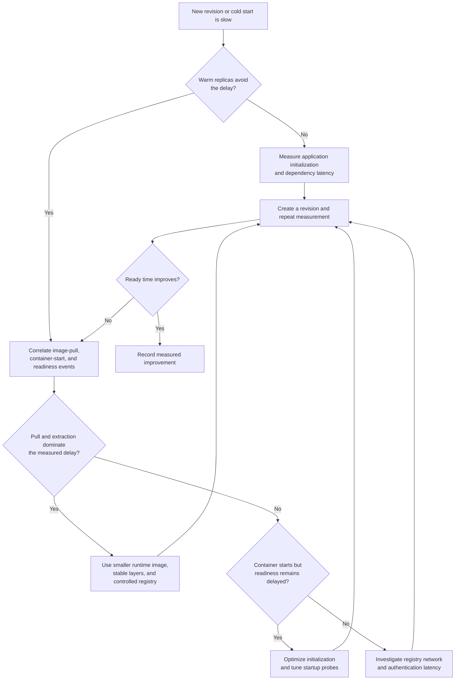

---
content_sources:
  references:
    - type: mslearn-adapted
      url: https://learn.microsoft.com/en-us/azure/container-apps/troubleshoot-container-start-failures
  diagrams:
    - id: image-size-startup-delay-decision-flow
      type: flowchart
      source: mslearn-adapted
      based_on:
        - https://learn.microsoft.com/en-us/azure/container-apps/troubleshoot-container-start-failures
        - https://learn.microsoft.com/en-us/azure/container-apps/containers
        - https://learn.microsoft.com/en-us/azure/container-apps/scale-app
content_validation:
  status: verified
  last_reviewed: 2026-07-18
  reviewer: ai-agent
  core_claims:
    - claim: A revision can fail or start slowly when container startup conditions are not met in Azure Container Apps.
      source: https://learn.microsoft.com/en-us/azure/container-apps/troubleshoot-container-start-failures
      verified: true
    - claim: Azure Container Apps revisions run the container image configured in the app template.
      source: https://learn.microsoft.com/en-us/azure/container-apps/containers
      verified: true
---
# Image Size Startup Delay

Use this playbook when new revisions eventually succeed but take far too long to become ready, especially after scale-from-zero or after an image update.

## Symptom

- New revisions remain in provisioning longer than expected.
- First requests after scale-out or scale-from-zero show large latency spikes.
- Startup probes fail only on fresh revisions or freshly pulled images.
- No single application exception explains the slow start window.

## Possible Causes

- The image is large, so pull and extraction time dominate startup.
- The image contains unnecessary build tools, package caches, or debug artifacts.
- Startup initialization does too much work after the image is pulled.
- Scale-to-zero exposes image pull latency more visibly than always-ready replicas do.

## Diagnosis Steps

<!-- diagram-id: image-size-startup-delay-decision-flow -->


*Figure: Image size is a supported hypothesis only when pull and extraction consume the measured startup window; otherwise investigate initialization, probes, or registry access.*

1. Capture the configured image and revision timeline.

    ```bash
    az containerapp show \
        --name "$APP_NAME" \
        --resource-group "$RG" \
        --query "properties.template.containers[0].image" \
        --output tsv

    az containerapp revision list \
        --name "$APP_NAME" \
        --resource-group "$RG" \
        --output table
    ```

    | Command or parameter | Purpose |
    |---|---|
    | `az containerapp show` | Extract the image URI to identify the registry and image name being used. |
    | `az containerapp revision list` | Show revision provisioning and ready times to compare how long fresh vs. warm revisions take to reach healthy state. |
    | `--name` | Target the app being analyzed. |
    | `--output` | Format image as tsv for parsing, revisions as table for side-by-side time comparison. |
    | `--query` | Extract the container image configuration value. |
    | `--resource-group` | Keep diagnostics scoped to the resource group containing the app. |

2. Review system logs for slow provisioning or repeated startup attempts.

    ```bash
    az containerapp logs show \
        --name "$APP_NAME" \
        --resource-group "$RG" \
        --type system
    ```

    | Command or parameter | Purpose |
    |---|---|
    | `az containerapp logs show` | Capture platform-level events showing when the image pull begins, when extraction completes, and when container startup is attempted. |
    | `--name` | Target the affected app. |
    | `--resource-group` | Keep logs in the resource group containing the app. |
    | `--type` | Request system logs to see provisioning and container start events (not application console output). |

3. Correlate revision creation and startup signals.

    ```kusto
    let AppName = "ca-myapp";
    ContainerAppSystemLogs_CL
    | where ContainerAppName_s == AppName
    | where TimeGenerated > ago(2h)
    | where Reason_s has_any ("RevisionProvisioning", "RevisionProvisioned", "ReplicaStarted", "ProbeFailed")
       or Log_s has_any ("pull", "start", "ready")
    | project TimeGenerated, RevisionName_s, ReplicaName_s, Reason_s, Log_s
    | order by TimeGenerated asc
    ```

4. Compare the behavior with scale-to-zero settings to see whether image pull cost is only visible on fresh replicas.

    ```bash
    az containerapp show \
        --name "$APP_NAME" \
        --resource-group "$RG" \
        --query "properties.template.scale" \
        --output json
    ```

    | Command or parameter | Purpose |
    |---|---|
    | `az containerapp show` | Retrieve the scaling configuration including minimum replicas and scale-to-zero rules. |
    | `--name` | Target the app being diagnosed. |
    | `--output` | Format as json to preserve scale rule structure and thresholds. |
    | `--query` | Extract the scale configuration to understand when replicas are allowed to scale to zero. |
    | `--resource-group` | Keep the query in the resource group containing the app. |

## Resolution

1. Reduce image size with multi-stage builds and by removing build-time tooling from the runtime image.
2. Keep language package caches, test assets, and debug binaries out of the production image.
3. Move expensive initialization out of the startup path where possible.
4. Keep one ready replica for user-facing apps if cold-start latency is unacceptable.

## Prevention

- Treat image size as a production SLO input, not just a build concern.
- Review image contents after dependency or base-image changes.
- Measure revision-ready time before and after image changes.
- Keep scale-to-zero decisions aligned with acceptable startup latency.

## See Also

- [Probe Failure and Slow Start](probe-failure-and-slow-start.md)
- [Docker Hub Rate Limit](docker-hub-rate-limit.md)
- [Cold Start and Scale-to-Zero Lab](../../lab-guides/cold-start-scale-to-zero.md)

## Sources

- [Troubleshoot container start failures in Azure Container Apps](https://learn.microsoft.com/en-us/azure/container-apps/troubleshoot-container-start-failures)
- [Containers in Azure Container Apps](https://learn.microsoft.com/en-us/azure/container-apps/containers)
- [Scaling in Azure Container Apps](https://learn.microsoft.com/en-us/azure/container-apps/scale-app)
